<p align="center">
  
</p>

<h3 align="center">A fast, polished operating system for RK3326 handhelds</h3>

<p align="center">
  <a href="https://github.com/zenmode-adri/Zenith/releases"></a>
  <a href="https://github.com/zenmode-adri/Zenith/releases"></a>
  
  
  
  <a href="https://ko-fi.com/zenmodeadri"></a>
</p>

Zenith is a system image for RK3326 handhelds: Linux 6.12, its own front-end (**zfront**), fast boot and suspend, and a
patched open GPU driver. It is an **unofficial fork** of [AURKNIX](https://github.com/AveyondFly/distribution_rocknix),
which is a fork of [ROCKNIX](https://github.com/ROCKNIX), developed and measured on the **R36 Ultra**.

> [!WARNING]
> **Tested only on the R36 Ultra.** Other RK3326 handhelds use the same image but have not been checked with these
> changes: treat them as beta. Zenith is not endorsed by, or affiliated with, ROCKNIX, AURKNIX or their authors; please do
> not report Zenith problems to them.

## Features

- **zfront, a front-end made for these consoles, is the default.** The console is ready about **13 s** after power-on,
  a game starts sooner and has more memory to run in. EmulationStation stays installed, one menu away. See
  [zfront and EmulationStation](#zfront-and-emulationstation).
- **Six themes:** Zenith Minimal (default) and Zenith Next, each light and dark, plus XMB, Art Book, Iconic and
  TechDweeb.
- **Fast suspend:** the console sleeps in **2.3 s** and wakes in **4.3 s**.
- **Battery screen:** charge, current use, history and what used the most.
- **R36 Tuner Next** built in: CPU, GPU and RAM clocks, voltage curves, profiles, benchmarks and a stability test, with
  live graphs. See [R36 Tuner Next](#r36-tuner-next).
- **Patched Panfrost (open GPU driver):** 39 % faster than stock Panfrost and close to Arm's libmali when you play.
  libmali stays the default. See [Panfrost vs libmali](#panfrost-vs-libmali).
- **Performance mode** (off by default): GPU and RAM at full speed while a game runs; Mario Tennis goes from 19.3 to
  25.0 fps. **RAM at 786 MHz** on the models that have that step.
- **Send files from your phone:** scan a QR code and upload games, folders, BIOS and saves from the browser (off by
  default).
- **Zenith DTB Selector** to pick the right screen for your console from Windows, Linux or macOS. See
  [`docs/DTB-SELECTOR.md`](docs/DTB-SELECTOR.md).
- English and Spanish everywhere.

## Screenshots

Taken on an R36 Ultra (720x720) running v0.2.0.

**zfront: Zenith Minimal and Zenith Next**

<table>
<tr>
<td align="center">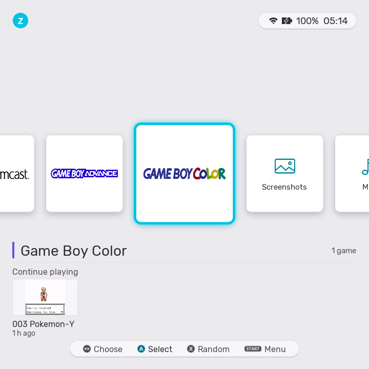<br/><sub>Zenith Minimal (default)</sub></td>
<td align="center">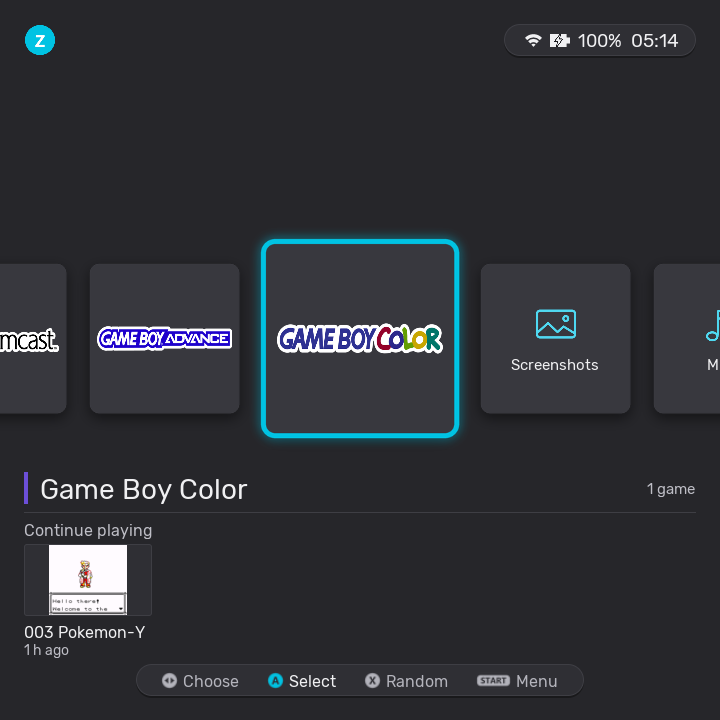<br/><sub>Zenith Minimal, dark</sub></td>
<td align="center">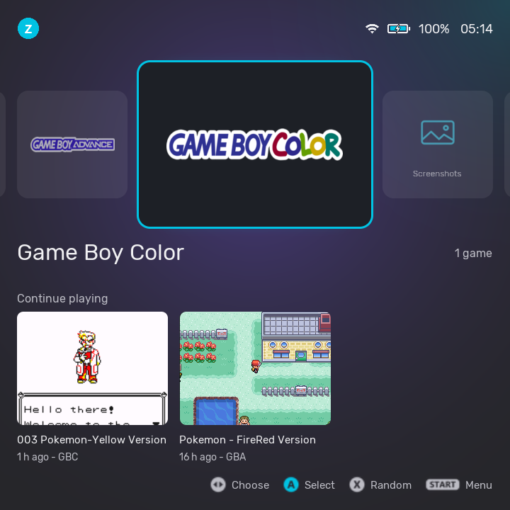<br/><sub>Zenith Next, with the continue-playing row</sub></td>
</tr>
<tr>
<td align="center">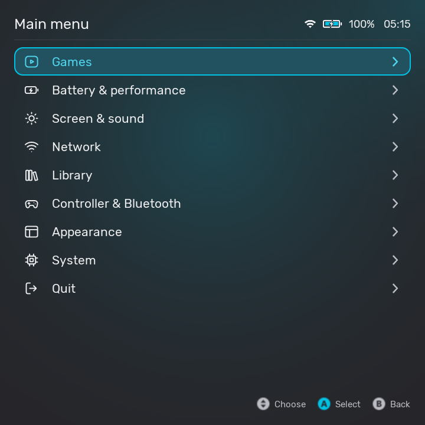<br/><sub>Main menu</sub></td>
<td align="center">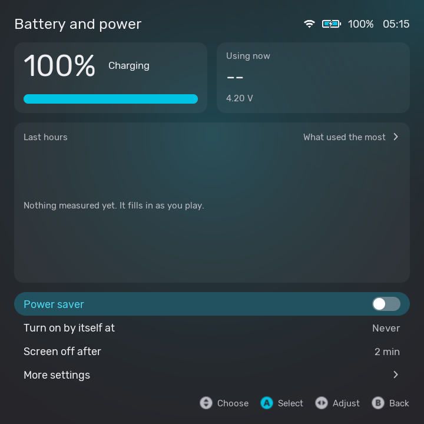<br/><sub>Battery and power</sub></td>
<td align="center">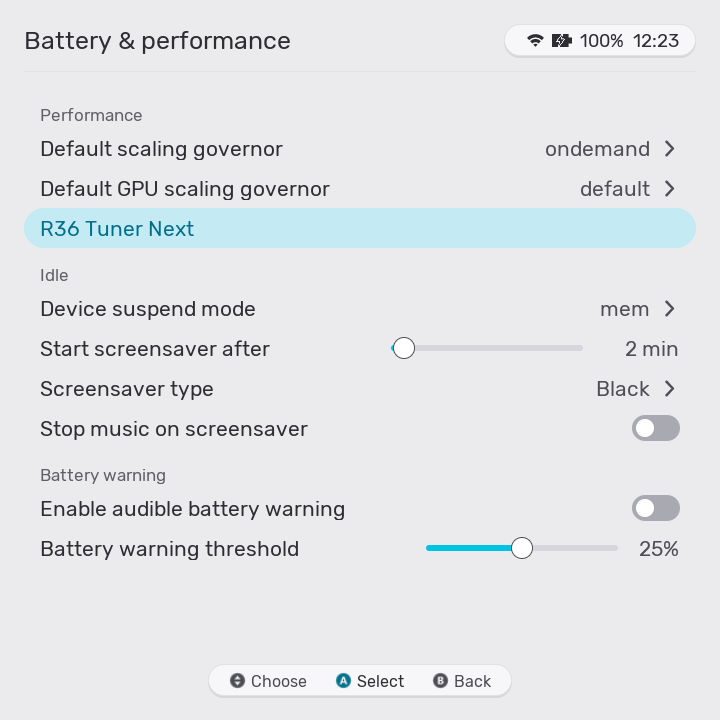<br/><sub>Battery &amp; performance settings</sub></td>
</tr>
<tr>
<td align="center">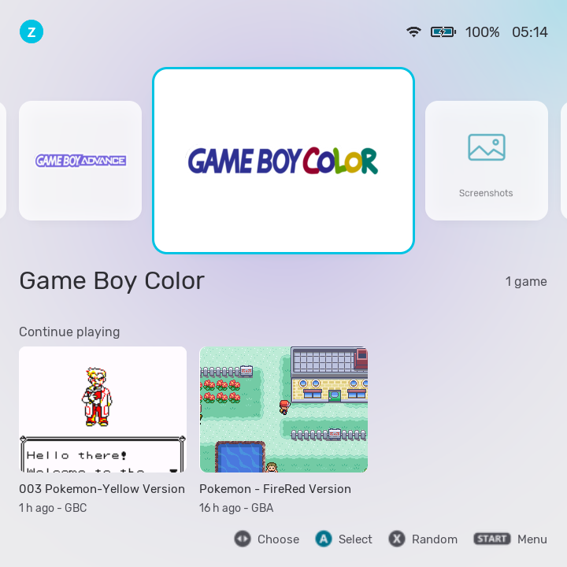<br/><sub>Zenith Next, light</sub></td>
<td></td><td></td>
</tr>
</table>

**R36 Tuner Next**

<table>
<tr>
<td align="center">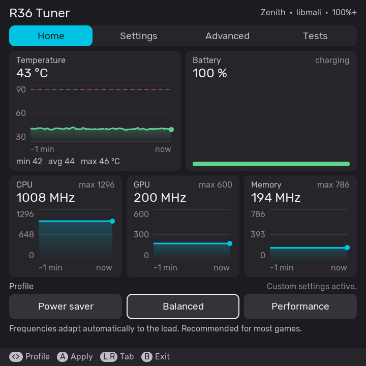<br/><sub>Live temperature, CPU, GPU and RAM, profiles</sub></td>
<td align="center">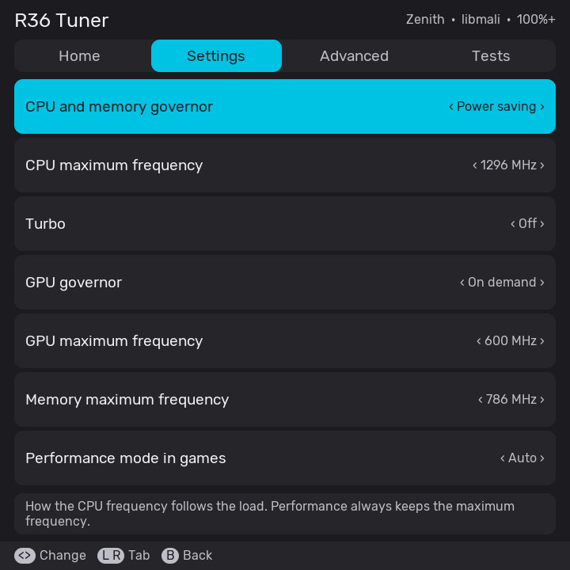<br/><sub>Governors, maximum clocks, performance mode</sub></td>
<td align="center">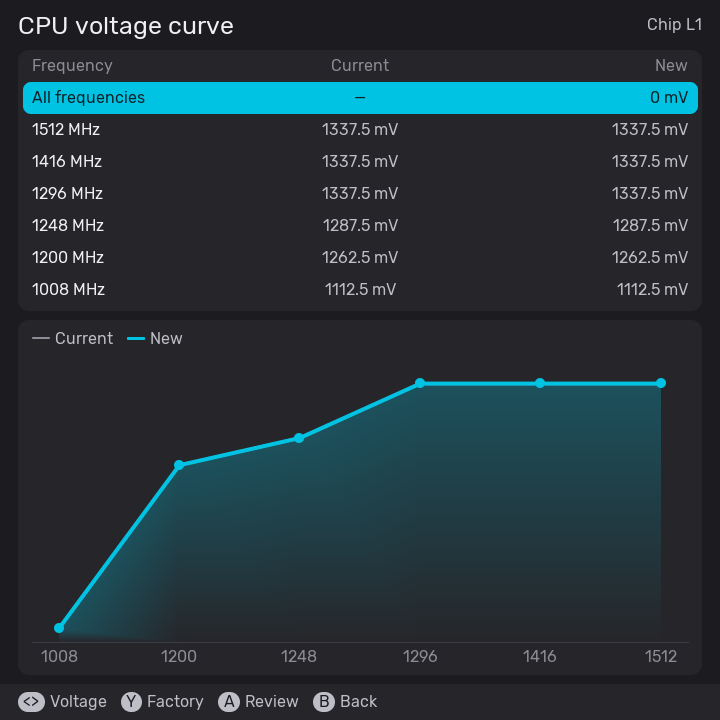<br/><sub>CPU voltage curve</sub></td>
</tr>
<tr>
<td align="center">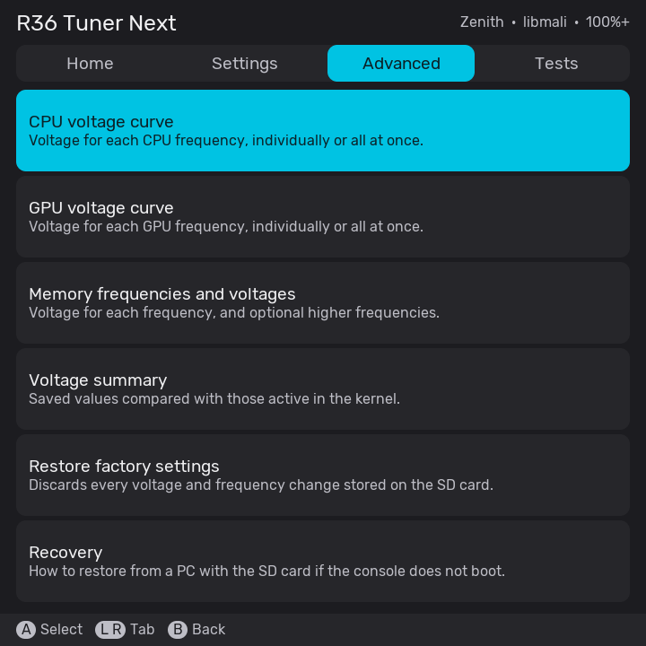<br/><sub>Voltages, factory settings, recovery</sub></td>
<td align="center">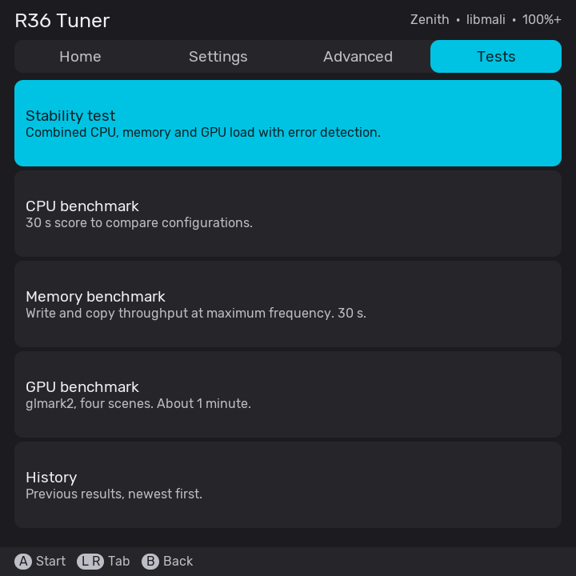<br/><sub>Stability test and benchmarks</sub></td>
<td></td>
</tr>
</table>

**The other themes**

<table>
<tr>
<td align="center">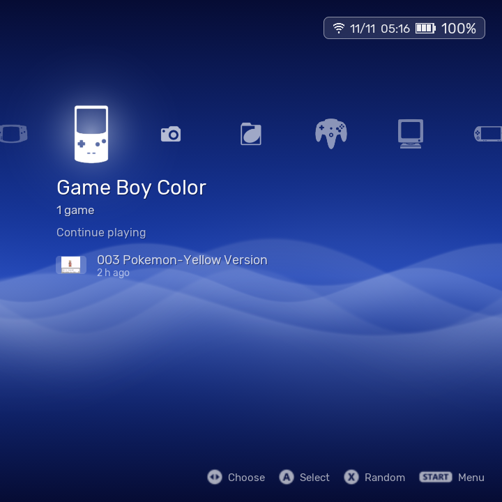<br/><sub>XMB</sub></td>
<td align="center">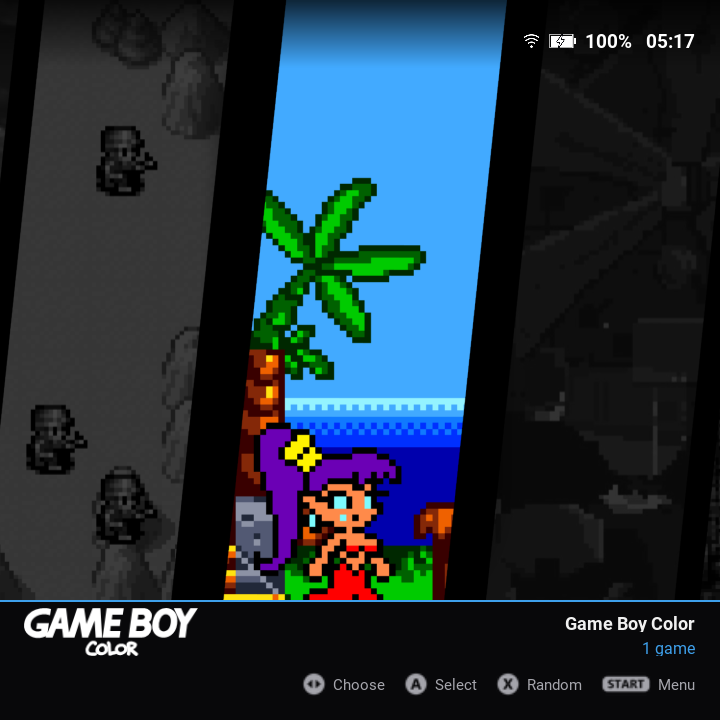<br/><sub>Art Book</sub></td>
<td align="center">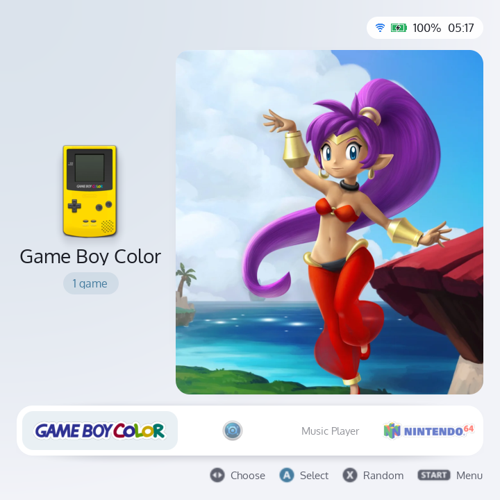<br/><sub>Iconic</sub></td>
<td align="center">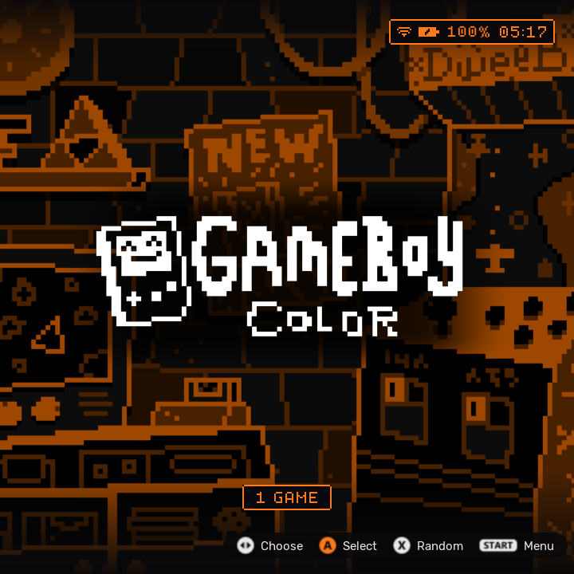<br/><sub>TechDweeb</sub></td>
</tr>
</table>

**EmulationStation, still installed** (`Tools > Switch frontend`)

<table>
<tr>
<td align="center">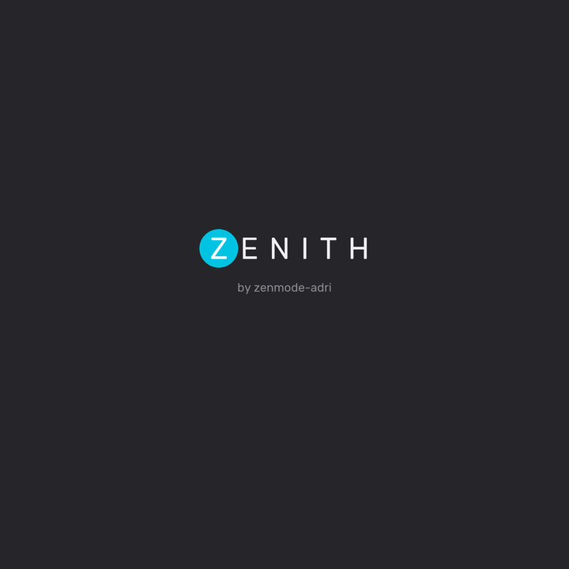<br/><sub>Start-up</sub></td>
<td align="center"><br/><sub>System carousel, dark</sub></td>
<td align="center">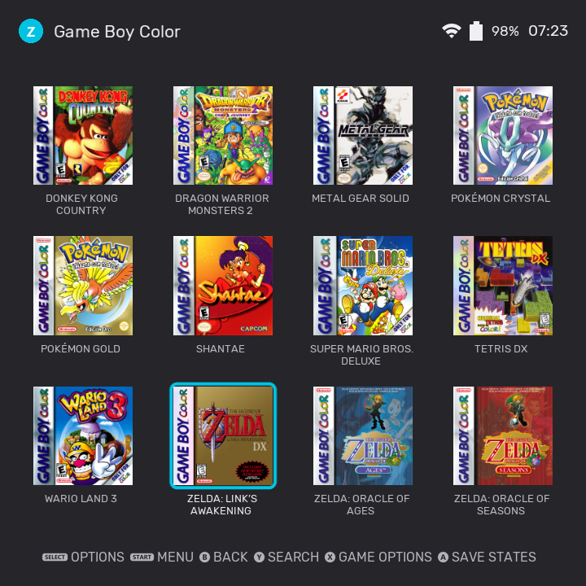<br/><sub>Game grid with box art</sub></td>
</tr>
</table>

---

## What changed

Measured on an **R36 Ultra**. Every change is listed in [`CHANGELOG.md`](CHANGELOG.md).

| | AURKNIX (base) | Zenith | Change |
|---|---:|---:|---:|
| Power-on to menu (zfront, three boots) | 33 s | **12.8-13.4 s** | **about -60 %** |
| Opening a game (EmulationStation) | 6.29 s | **3.85 s** | **-39 %** |
| Suspend | 3.5 s | **2.3 s** | **-34 %** |
| Resume | 8 s | **4.3 s** | **-46 %** |
| First button press after idle (EmulationStation) | 225-245 ms | **11 ms** | **-95 %** |

> The AURKNIX boot was timed with a stopwatch; Zenith's is the moment the front-end draws its first frame. The rows marked
> EmulationStation and the suspend times were measured on v0.1.0. Thanks to AURKNIX and ROCKNIX for the base these numbers
> start from.

### zfront and EmulationStation

EmulationStation (ES) is a complete, mature front-end, and Zenith keeps it installed and themed. zfront reads the same
settings, game lists, collections, themes and scripts, so you can switch back and forth from `Tools > Switch frontend`
without setting anything up twice, and a console that already uses ES keeps it after an update. zfront is a smaller
program written from scratch for these 1 GB consoles; on a fresh install it is the default.

Measured on an **R36 Ultra**, one to three runs per point:

| | EmulationStation | zfront |
|---|---:|---:|
| Power-on to menu, same image (three boots each) | 15.6 / 17.0 / 18.2 s | **12.8 / 13.4 / 13.4 s** |
| First screen after start (large library) | 4.1 s | **1.0 s** |
| Start a RetroArch game | 1.18 s | **0.91 s** |
| Front-end memory in the menus | 143 MB | **36 MB** |
| Front-end memory while a game runs (God of War) | 90-100 MB | **10-11 MB** |
| Memory the game can still use (God of War, Dead or Alive 2) | 456-488 MB | **504-528 MB** |

- It does **not** make games run faster: in God of War the frame rate is the same with both. What it gives a game is
  room: 32-48 MB more memory. That is less than the difference in size between the two front-ends, because Linux
  compresses the memory a front-end is not using while a game runs.
- It does what ES does (game lists, collections, metadata editor, scrapers, music, video previews, manuals, netplay,
  Kiosk and Kid modes) and adds a continue-playing row, save backups, a library check, play statistics, the battery
  screen and the phone file transfer. More in [`docs/ZFRONT.md`](docs/ZFRONT.md).

### R36 Tuner Next

R36 Tuner Next opens from the Tools menu. Its home page shows live graphs of
temperature and of the CPU, GPU and RAM clocks, with three profiles (Power saver, Balanced, Performance). Settings sets
the governors, the maximum clocks, turbo and the performance mode for games. Advanced edits the CPU and GPU voltage
curves and the memory steps, restores the factory values and explains how to recover from a PC. Tests runs a stability
test and CPU, memory and GPU benchmarks, with a history of results. Voltage changes have a boot safety net; they were
tested on an R36 Ultra only in part.

### Other changes
- **Games start 0.2-0.5 s faster** in RetroArch, with either front-end.
- **PSP:** PPSSPP 1.20.2 is the default (the 2021 build stays selectable).
- **GPU freezes fixed:** changing the GPU speed limit across 480 MHz used to freeze the console within about a minute;
  after the fix, more than 25,000 changes per console without a freeze.
- **Low battery** closes the game and lets it save before powering off. **Volume keys** repeat faster when held and show the
  volume bar at 0 % and 100 %. **Samba** asks for the root password.
- **Battery gauge** tables for the R36S panel 4, R36XX Pro Max, R40XX and R45H/R46H follow the maker's (not tried on those
  consoles).
- **Zenith DTB Selector** (Windows, Linux, macOS; English, Spanish and Chinese) lists 86 models, shows what will change
  before writing and keeps backups. Its test mode, which tries the candidates one boot at a time for consoles whose model
  is unknown, is **not yet tested on hardware**.

> [!NOTE]
> Zenith adds no new emulators and does not update cores (apart from PPSSPP 1.20.2); those come from AURKNIX. Builds and
> settings we measured and did not ship: [`docs/TESTED-NOT-SHIPPED.md`](docs/TESTED-NOT-SHIPPED.md).

> [!IMPORTANT]
> **Known issues.** The cover scraper (ScreenScraper) does **not** work in this image: no developer credentials are built
> in. The root password is still `rocknix` (SSH and Samba are off by default; change it before turning them on).
> Only the R36 Ultra has been tested.

## Panfrost vs libmali

Panfrost is the open-source driver for the console's GPU (Mali-G31). Zenith ships it with 19 patches to Mesa 26.0.4 and an
optimised build; libmali (Arm's driver) stays the default because it has been tested the longest and supports OpenGL ES
3.2 (Panfrost: 3.1). To try Panfrost, pick `GPU DRIVER > Panfrost` in the menu; it takes effect after a reboot, and picking libmali goes back. If
Panfrost cannot start, the console goes back to libmali by itself.

Two tests. **At real speed** is how a game feels when you play it. The **free-running test** lets every game run as fast
as it can: it shows how much work each driver gets through, but most of its differences shrink at real speed.

### At real speed

Measured on the **R36S** the way you play (vsync and audio sync on, same save states, CPU at 1296 MHz, one run per point,
so differences under 5 % may be noise). "Auto" is how the console ships; "RAM fixed" pins the RAM at 666 MHz; "GPU + RAM
fixed" also pins the GPU at 600 MHz, which is what the performance mode does on models without the 786 MHz step. fps:

| Game (N64) | libmali auto | libmali RAM fixed | libmali GPU + RAM fixed | Panfrost auto | Panfrost RAM fixed | Panfrost GPU + RAM fixed |
|---|---:|---:|---:|---:|---:|---:|
| Mario Tennis | 19.3 | 22.7 | 25.0 | 18.0 | 22.4 | **26.6** |
| Wave Race 64 | 35.1 | 37.6 | 38.9 | 40.5 | **44.9** | 44.7 |
| Mario Kart 64 (ParaLLEl) | 21.3 | 23.8 | 24.5 | 22.3 | 24.5 | **24.8** |
| GoldenEye 007 | 39.6 | 36.9 | 37.8 | 38.1 | **40.8** | 40.7 |
| Zelda: Ocarina of Time | 15.5 | **16.6** | 16.5 | 16.1 | **16.7** | 16.6 |

- **With the default automatic clocks the two drivers are close:** from −7 % (Mario Tennis) to +15 % (Wave Race 64).
- **The automatic clocks hold games back, with either driver.** An emulator uses the GPU in short bursts, so the
  automatic governors see little load and keep the GPU and RAM slow. Pinning the RAM alone already gives a large part of
  the gain; that is what the **performance mode** does while a game runs (off by default; on for all games, per system or
  per game). Heat and battery use in long sessions are not measured yet: the R36 Ultra shut down in long God of War
  sessions with the GPU pinned, which is why it is off by default.
- **Zelda** barely moves in any column; **GoldenEye with libmali** was slower with fixed clocks than on auto (not
  explained).
- **God of War** (PSP): 7.8 fps with libmali, 8.2 with stock Panfrost and 8.4 with patched Panfrost. It is limited by the
  CPU, so neither the driver nor the GPU clock changes much there.

**R36 Ultra**, patched Panfrost, same games, with the RAM at 666 or 786 MHz. The 786 MHz step is in the image on the
same boards [dArkOSen](https://github.com/djparentx/dArkOSen-R36S) enables it on (the original R36S V12/V20/V21/V22/Y02,
R36S Plus, R36H, R45H, R46H, the R36S Sauce) and on the R36 Ultra; clones and other models stay at 666 MHz. fps:

| Game (N64) | Auto, RAM up to 666 | Auto, RAM up to 786 | Fixed GPU 600 + RAM 666 | Fixed GPU 600 + RAM 786 (performance mode) |
|---|---:|---:|---:|---:|
| Mario Tennis | 15.7 | 19.8 | 27.2 | **29.0** |
| Wave Race 64 | 41.9 | 46.4 | 48.4 | **49.0** |
| GoldenEye 007 | 34.8 | 35.6 | 40.2 | **41.1** |
| Mario Kart 64 (ParaLLEl) | 24.8 | **25.0** | 24.8 | 24.8 |
| Zelda: Ocarina of Time | **16.8** | 16.6 | 16.5 | 16.6 |

- **Fixing the clocks is the big step on the Ultra too:** Mario Tennis +74 %, GoldenEye +16 %, Wave Race 64 +15 %.
- **RAM at 786 MHz adds little on top** (Mario Tennis +6 %, GoldenEye +2 %, Wave Race 64 +1 %, one run).
- **Stable in our tests:** `memtester` (300 MB) ran 6 full passes in 57 minutes at 786 MHz with no errors (65 °C at
  most), on one R36 Ultra. The other boards get the step because dArkOSen ships it on them; we have not tested those.

### Free-running test (20 games)

20 games on an **R36S** and an **R36 Ultra**, three drivers: **libmali** (the Zenith default), **stock Panfrost** and
**our patched Panfrost**. Same save state and same frames for every driver, uncapped, with fixed clocks, two runs each.
Full tables, method and screenshots of all 20 games: [`docs/PANFROST-STUDY.md`](docs/PANFROST-STUDY.md).

| | R36S | R36 Ultra |
|---|---:|---:|
| Patched Panfrost vs libmali: wins / ties (±5 %) / losses, out of 20 | **7 / 12 / 1** | **8 / 12 / 0** |
| Patched Panfrost vs libmali, average of the 20 games | **+4.4 %** | **+6.5 %** |
| Patched vs stock Panfrost, average | **+38.9 %** | **+38.9 %** |
| Stock Panfrost vs libmali, average | −24.8 % | −23.3 % |
| glmark2 score: libmali / stock / patched | 380 / 386 / **434** | 358 / 368 / **414** |

Biggest differences (fps, libmali -> patched Panfrost):

| Game | System · core | R36S | R36 Ultra |
|---|---|---:|---:|
| Wave Race 64 | N64 · Mupen64Plus-Next | 57.0 -> **65.4** (+15 %) | 53.6 -> **62.9** (+17 %) |
| Zelda: Ocarina of Time | N64 · ParaLLEl N64 | 25.1 -> **28.7** (+15 %) | 24.2 -> **28.1** (+16 %) |
| Mario Kart 64 | N64 · ParaLLEl N64 | 33.6 -> **38.4** (+14 %) | 32.2 -> **37.1** (+15 %) |
| Mega Man 64 | N64 · Mupen64Plus-Next | 127.8 -> **139.7** (+9 %) | 123.8 -> **134.8** (+9 %) |
| GoldenEye 007 | N64 · Mupen64Plus-Next | **44.0** -> 41.3 (−6 %) | **42.0** -> 40.9 (−3 %) |

No GPU faults in any run, and stock and patched Panfrost draw the same picture in 18 of the 19 games compared pixel by
pixel.

<table>
<tr>
<td align="center">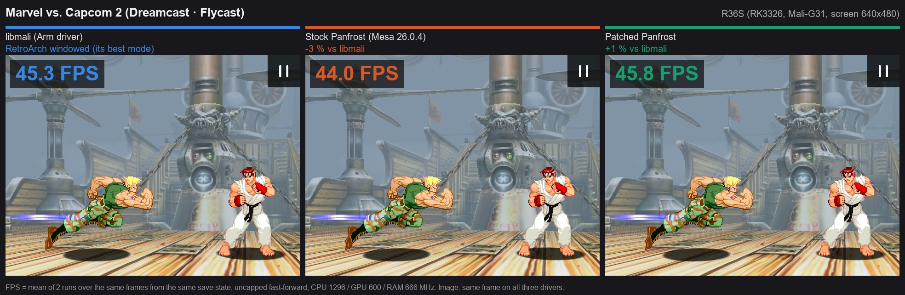<br/><sub>Marvel vs. Capcom 2 (Dreamcast), R36S: the same frame on the three drivers</sub></td>
<td align="center">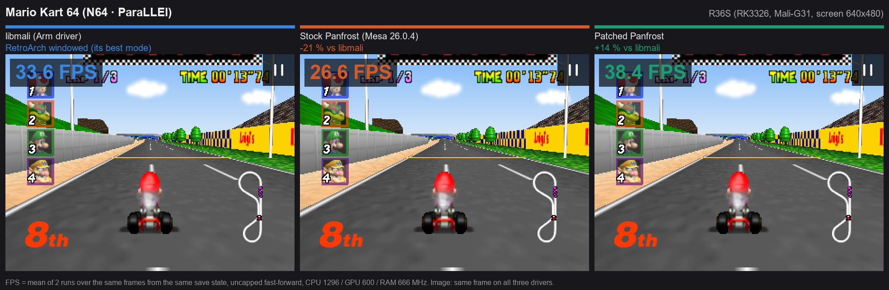<br/><sub>Mario Kart 64 (N64), R36S: the same frame on the three drivers</sub></td>
</tr>
</table>

**What the patches do** (general, nothing per game; each gain was measured alone, running free, so they do not add up):
- Faster reads of game data and of the finished picture, which the driver used to read from slow GPU memory. Mario Kart
  64 (ParaLLEl) +24 %.
- OpenGL work can run on a second CPU thread (glthread), turned on for RetroArch and PPSSPP. Mario Kart 64 +23 %.
- A shader compiler tuned for the big shaders emulators use. GoldenEye 23.5 -> 32 fps on the Ultra.
- Up to three frames in flight instead of one, so the CPU does not wait for the GPU at every frame. GoldenEye +7 % to
  +13 %; it can add up to two frames of input delay (not measured).
- A Panfrost bug fixed that made the GPU read the wrong data (page faults and GPU resets): now none.
- Everything is on by default; the optimised build adds 0 to +3 %.

> [!NOTE]
> Not measured: battery use and input latency. Under RetroArch in fullscreen, libmali never goes above 60 fps, so libmali
> was measured both fullscreen and windowed and every game uses its best result.

---

## Install

1. Download `AURKNIX-RK3326.aarch64-<date>.img.gz` from the [Releases](https://github.com/zenmode-adri/Zenith/releases) page
   and check the `.sha256`.
2. Decompress it and write it to an SD card with an imaging tool (Balena Etcher, Raspberry Pi Imager, `dd`).
   Double-check the target disk: writing an image erases everything on it.
3. For a console other than the R36 Ultra, pick its device tree with **Zenith DTB Selector** (`ZenithDtbSelector.exe` on
   the boot partition, also for Linux and macOS): see [`docs/DTB-SELECTOR.md`](docs/DTB-SELECTOR.md).

**Updating:** from v0.2.0 on, the built-in updater offers new releases. Coming from v0.1.0, write the image again (back up
your saves first): v0.1.0's updater looked at the original AURKNIX repository.

## Under the hood

- **Kernel:** Linux 6.12 with upstream drivers, plus the RK3326 patches in `projects/ROCKNIX/devices/RK3326/patches/linux/`:
  CPU/GPU voltage bins and clock tables (CPU 1296 MHz by default, 1416 and 1512 MHz as opt-in turbo; GPU 200-600 MHz),
  memory frequency scaling ported from the Rockchip BSP by KK (AveyondFly) of AURKNIX, RK915 Wi-Fi and RK817 battery
  fixes, the R36 Ultra joystick LED driver.
- **Suspend** is a real suspend-to-RAM (about 20-25 mA while asleep, estimated from the battery counter). It relies on
  upstream fixes that Zenith carries: SD card and USB resume (ROCKNIX pull requests #3304 and #3303, by Jacob Cook) and
  the RK817 battery gauge across sleep (#3305, by Chris Morgan). Zenith adds the Wi-Fi reload around sleep and runs the
  suspend steps in parallel.
- **Boot:** a small initramfs hands over to systemd as soon as the SD card is ready; the GPU, the display and the
  front-end then start in parallel.
- **Front-ends:** zfront is in `projects/ROCKNIX/packages/ui/zfront/`; EmulationStation, with Zenith's patches, in
  `projects/ROCKNIX/packages/ui/emulationstation/`.

## Building

```bash
PROJECT=ROCKNIX DEVICE=RK3326 ARCH=aarch64 ./scripts/build_distro
```

A full build needs several hours and about 100 GB of free disk. Keep at least 6 GB free on the drive that holds the
images, or the last step (copying the image) can fail.

---

## About this fork

Zenith is an unofficial fork. The device and emulator lists, features and manuals of the base distribution are
documented upstream, not here:

- [AURKNIX](https://github.com/AveyondFly/distribution_rocknix) by **lcdyk** and **KK** (GitHub: AveyondFly): the fork Zenith is built on.
- [ROCKNIX](https://github.com/ROCKNIX): the distribution AURKNIX is forked from.

Everything else in the repository comes from them. What Zenith adds or changes is listed in
[`CHANGELOG.md`](CHANGELOG.md) and [`ZENITH.md`](ZENITH.md). Maintained by
[zenmode-adri](https://github.com/zenmode-adri); see [`CREDITS.md`](CREDITS.md) for the people and projects this work
stands on.

## Licenses

**AURKNIX** is a fork of **ROCKNIX**; ROCKNIX derives from [JELOS](https://github.com/JustEnoughLinuxOS/distribution/). All applicable licenses apply and credit to the JELOS and ROCKNIX teams. 

You are free to:

- Share: copy and redistribute the material in any medium or format
- Adapt: remix, transform, and build upon the material

Under the following terms:

- Attribution: You must give appropriate credit, provide a link to the license, and indicate if changes were made. You may do so in any reasonable manner, but not in any way that suggests the licensor endorses you or your use.
- NonCommercial: You may not use the material for commercial purposes.
- ShareAlike: If you remix, transform, or build upon the material, you must distribute your contributions under the same license as the original.

### Bundled Works
All other software is provided under each component's respective license. These licenses can be found in the software sources or in this project's licenses folder. Modifications to bundled software and scripts by the JELOS and ROCKNIX teams are licensed under the terms of the software being modified.

## Credits

Zenith exists thanks to **lcdyk** and **KK** (GitHub: **AveyondFly**), the authors of AURKNIX, whose RK3326 device trees,
emulators and tooling this fork is built on. Thank you.

Thanks also to the **ROCKNIX** and **JELOS** teams, and to CoreELEC, LibreELEC and the many open source developers
whose work makes a distribution like this possible. See [`CREDITS.md`](CREDITS.md) for the full list.

If you would like to support **lcdyk**, maintainer of AURKNIX, you can use Ko-fi: [https://ko-fi.com/lcdyk](https://ko-fi.com/lcdyk).
