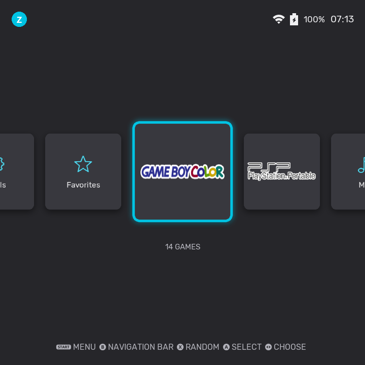
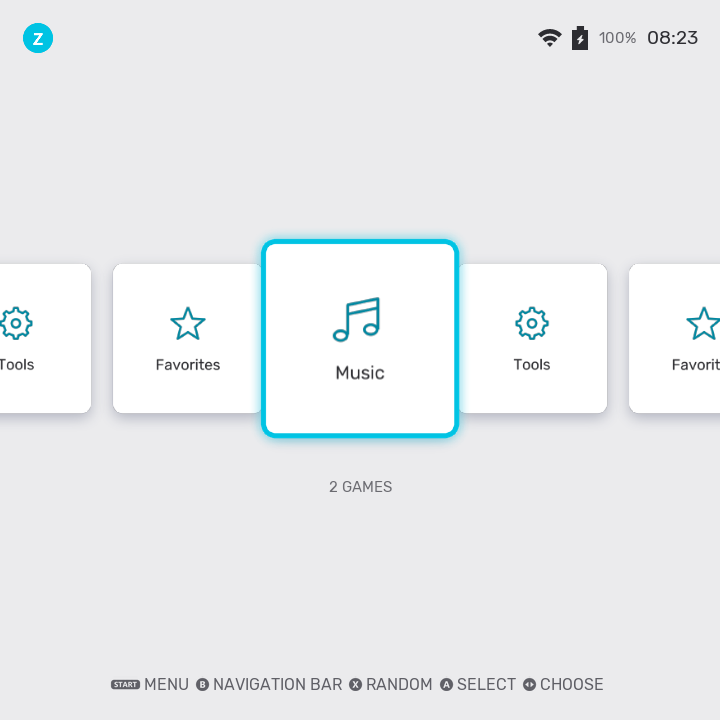
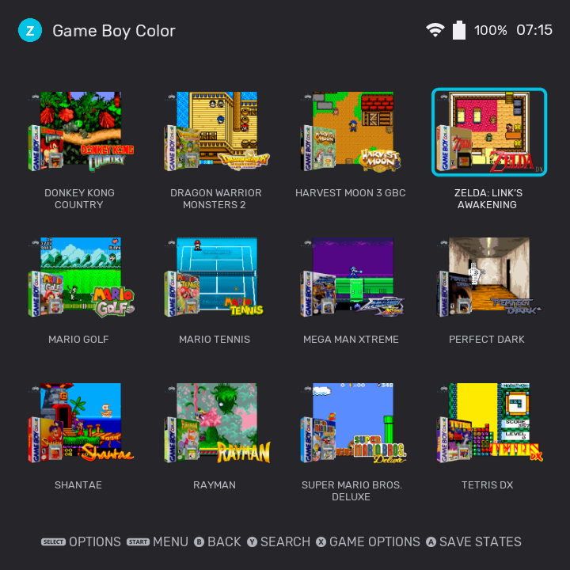
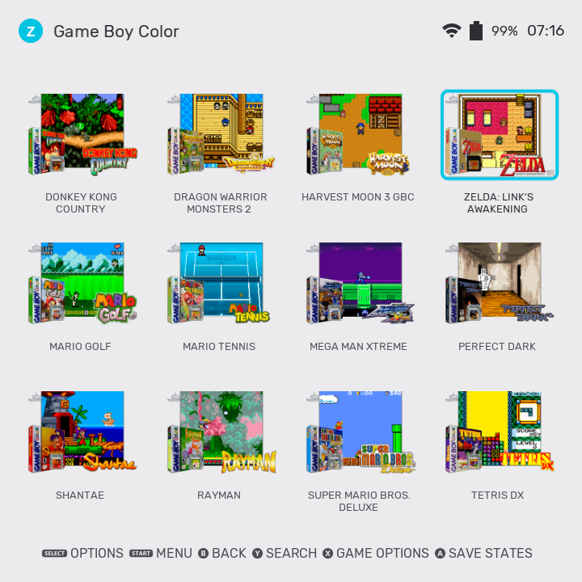
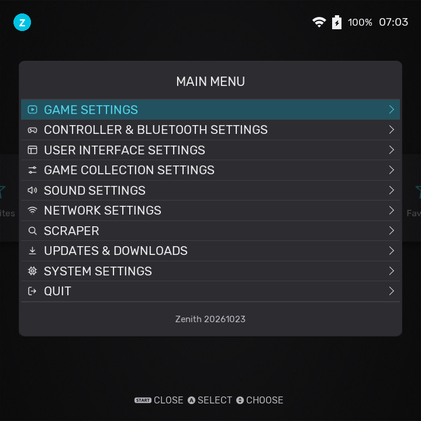
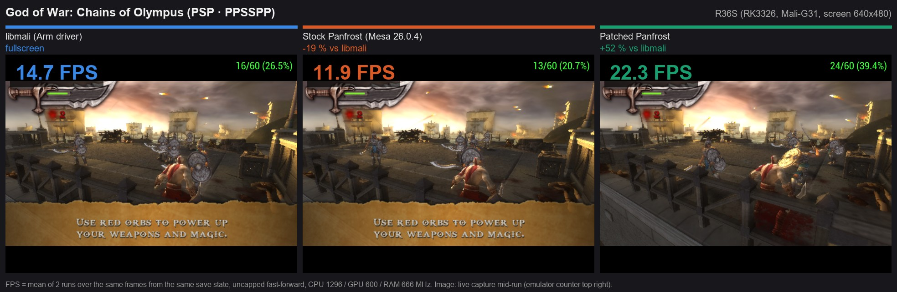
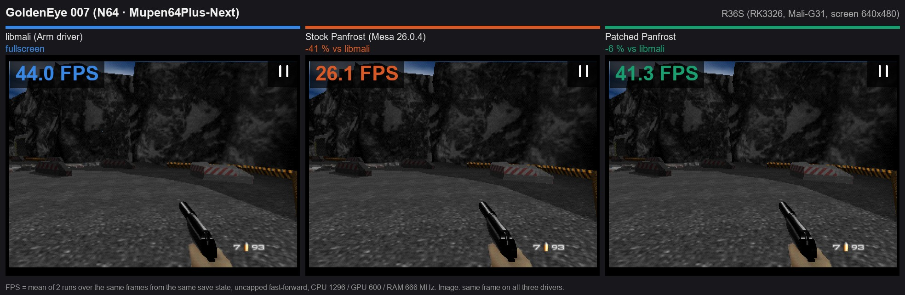

<p align="center">
  
</p>

<h3 align="center">A fast, polished operating system for RK3326 handhelds</h3>

<p align="center">
  <a href="https://github.com/zenmode-adri/Zenith/releases"></a>
  <a href="https://github.com/zenmode-adri/Zenith/releases"></a>
  
  
  
  <a href="https://ko-fi.com/zenmodeadri"></a>
</p>

Zenith is its own system image: Linux 6.12 mainline, EmulationStation with a custom light/dark theme, and a boot and
suspend path tuned for speed. It is an **unofficial fork** of
[AURKNIX](https://github.com/AveyondFly/distribution_rocknix), which is a fork of [ROCKNIX](https://github.com/ROCKNIX),
developed and measured on the **R36 Ultra**.

> [!WARNING]
> **Tested only on the R36 Ultra.** Other RK3326 handhelds use the same image and device-tree selector but have not been
> checked with these changes. Targets other than RK3326 are inherited from upstream and were not built or tested.
> Zenith is not endorsed by, or affiliated with, ROCKNIX, AURKNIX or their authors; please do not report Zenith problems
> to them.

## Features

- **Fast boot**: about **15 s** from power-on to the menu (33 s before). GPU, display, Sway and EmulationStation start in
  parallel as soon as storage is ready.
- **Fast suspend**: the console sleeps in **2.3 s** and wakes in **4.3 s**.
- **Games open in 3.85 s** (6.29 s before), and the menus answer on the first button press (**11 ms**).
- **Own interface**: light and dark theme, redesigned dialogs, keyboard, sliders and carousel, a clean Tools menu and
  first-boot screens.
- **Mainline kernel**: Linux 6.12 with upstream drivers, plus a patch set for the RK3326.
- **Faster open GPU driver** (next image): our patched Panfrost is 39 % faster than stock Panfrost and level with or
  slightly ahead of Arm's libmali when games run free (+4 to +7 % on average over 20 games). At real speed the
  difference is small: from −7 % to +15 % in five N64 games, and little in God of War (7.8 -> 8.4 fps), which is
  limited by the CPU. libmali stays the default. See [Panfrost vs libmali](#panfrost-vs-libmali).
- **R36 Tuner Next** built in: CPU governor and frequencies, turbo steps, benchmarks and a monitor.
- **zfront**, an optional lighter front-end next to EmulationStation (which stays the default): first screen in 1.0 s instead
  of 4.1 s and about a quarter of the memory. See [`docs/ZFRONT.md`](docs/ZFRONT.md).
- **Zenith DTB Selector** to pick the right screen/device tree for your console from Windows, Linux or macOS, with a test
  mode for clones whose model is unknown. See [`docs/DTB-SELECTOR.md`](docs/DTB-SELECTOR.md).

## Screenshots

<table>
<tr>
<td align="center"><br/><sub>Start-up</sub></td>
<td align="center"><br/><sub>Main menu, dark</sub></td>
<td align="center"><br/><sub>Main menu, light</sub></td>
</tr>
<tr>
<td align="center"><br/><sub>Game grid with box art, dark</sub></td>
<td align="center"><br/><sub>Game grid with box art, light</sub></td>
<td align="center"><br/><sub>Settings menu</sub></td>
</tr>
</table>

---

## What changed

Measured on an **R36 Ultra**. Details and the git tag of every change are in [`CHANGELOG.md`](CHANGELOG.md). More
measurements, with charts: [`docs/COMPILER-STUDY.md`](docs/COMPILER-STUDY.md) (does compiling the emulators differently
make them faster? Mostly no) and [`docs/DTB-SELECTOR.md`](docs/DTB-SELECTOR.md).

GPU drivers: [`docs/PANFROST-STUDY.md`](docs/PANFROST-STUDY.md) compares libmali, stock Panfrost and our patched
Panfrost in 20 games on the R36S and the R36 Ultra, with screenshots. In that free-running test our Panfrost matches or
beats libmali in 19 of 20 games on the R36S and in all 20 on the Ultra; at real speed the difference is smaller. It is
built into the next image, and libmali stays the default for safety and compatibility. Summary in
[Panfrost vs libmali](#panfrost-vs-libmali).

| | AURKNIX (base) | Zenith | Change |
|---|---:|---:|---:|
| Power-on to menu | 33 s | **15 s** | **-53 %** |
| Opening a game | 6.29 s | **3.85 s** | **-39 %** |
| Suspend | 3.5 s | **2.3 s** | **-34 %** |
| Resume | 8 s | **4.3 s** | **-46 %** |
| First button press after idle | 225-245 ms | **11 ms** | **-95 %** |

> AURKNIX is the base image Zenith started from. Zenith's boot time comes from the boot log plus the bootloader
> (3.11 s -> 2.11 s).
>
> Thanks to AURKNIX and ROCKNIX for the base these numbers start from.

### zfront vs EmulationStation

zfront is an optional second front-end, written from scratch and installed next to EmulationStation (ES). It reads the same
settings, gamelists, theme and scripts, so you can switch back and forth from `Tools > Switch frontend`. Measured on an
**R36 Ultra** (one run each, not a statistical benchmark):

| | EmulationStation | zfront |
|---|---:|---:|
| First screen after start (large library) | 4.1 s | **1.0 s** |
| Front-end memory in the menus | 143 MB | **36 MB** |
| Front-end memory while a game runs | 170 MB | **22.5 MB** |
| CPU when idle (ticks per 10 s) | 35 | **2** |
| Start RetroArch from the front-end | 1.18 s | **0.91 s** |

It does **not** make games faster: in God of War (the only game measured) the frame rate is the same with both. ES is still
the default; zfront has not been tried yet on the console with a physical pad, real sound or suspend from its menu.

### Boot and power
- GPU, display, Sway and EmulationStation start in parallel as soon as storage is ready; u-boot `BOOTDELAY=0`; faster SD
  probing in the initramfs.
- Suspend runs Wi-Fi shutdown, panel and the rest in parallel; governors are restored first on wake-up.
- Silent shutdown (no red message) and quiet boot.

### Interface
- Own light and dark EmulationStation theme, readable card labels and higher contrast.
- Redesigned switches, sliders, keyboard, dialogs, scrollbars and Information screen (ES patches 0001-0054).
- System carousel with equal 22 px gaps, no jumping neighbours and a steady speed when holding a direction.
- System / Network Settings open at once and fill their lists in the background; faster Wi-Fi menu.
- Fewer confirmation prompts in the quit menu.
- Tools menu with an icon and a description for every tool; 15 dead entries removed.
- Own first-boot screens, language question and boot banner.
- **zfront, an optional second front-end** written from scratch in C++17 and installed next to EmulationStation, which stays
  the default (`Tools > Switch frontend`). Same settings, gamelists, theme and scripts. On an R36 Ultra: first screen in
  1.0 s instead of 4.1 s, 36 MB of memory instead of 143 MB, almost no CPU when idle; in the only game measured (God of
  War) the frame rate is the same as with EmulationStation. Still unchecked on the console: a physical pad, real sound and
  suspend from its menu. Details in [`docs/ZFRONT.md`](docs/ZFRONT.md) and the [CHANGELOG](CHANGELOG.md).

### Opening games and graphics
- RetroArch games start 0.2-0.5 s faster: the script that writes the per-game configuration went from about 220 processes to
  about 40 and produces byte-identical files (compared on 14 systems).
- **The open-source GPU driver (Panfrost) now works on the RK3326**, so the `GPU DRIVER` choice in the menu is usable (kernel
  patch `036-opp-single-voltage-is-minimum`; before it, choosing Panfrost left the console on software rendering). If it
  fails to bind the GPU at boot, the system saves libmali and reboots once.
- **libmali stays the default, for safety and compatibility.** It is the driver this image has been tested with the
  longest and it offers OpenGL ES 3.2 (Panfrost 3.1). In the current release the Panfrost of the `GPU DRIVER` menu is
  Mesa's stock driver, which is slower than libmali (about -24 % on average over the 20 games of the study); from the
  next image it is our patched driver (below).

### GPU driver: our patched Panfrost (in the next image)
Panfrost is the open-source driver for the Mali-G31. With our 19 patches to Mesa 26.0.4 (17 active), plus a build with
profile-guided optimisation (PGO) and link-time optimisation (LTO), it is 39 % faster than stock Panfrost and level
with or slightly ahead of libmali when games run free (fast-forward, fixed clocks): it matches or beats libmali in 19
of 20 games on the R36S and in all 20 on the R36 Ultra (+4.4 % and +6.5 % on average, ties within 5 %), and it scores
434 vs 380 (R36S) and 414 vs 358 (Ultra) in glmark2. **At real speed the gain is smaller**: from −7 % to +15 % in five
N64 games, and God of War stays limited by the CPU (see [At real speed](#at-real-speed)). Zero GPU faults in every
test. Full study with screenshots of the same frame on all three drivers:
[`docs/PANFROST-STUDY.md`](docs/PANFROST-STUDY.md). It is built into the next image (installed by OTA and tested on an
R36S and an R36 Ultra), and libmali stays the default. To use it, pick `GPU DRIVER > Panfrost` in the menu, or run
`gpudriver panfrost` and reboot; `gpudriver libmali` and a reboot go back.

What the patches do (all general, nothing per game). Each gain was measured on its own, on the game named, so they do
not add up:
- **Index data read from cached memory** (`003`): the min/max scan of index buffers used to read write-combined GPU
  memory at about 5 MB/s; it now reads a cached copy. God of War +8 % at 2x.
- **Buffer mappings kept and a cheaper buffer path** (`001`, `002`): buffers that go back to the cache keep their CPU
  mapping, and tracing and labelling work is gone from the hot path.
- **Mesa's GL thread (glthread) allowed** (`004`, `005`): Panfrost now declares what Mesa needs to run OpenGL calls on
  a second thread, with the locking that makes it safe. Mario Kart 64 (ParaLLEl) +23 %.
- **Shader compiler tuned for the emulators' ubershaders** (`008`-`013`, `019`): uniforms that decide branches and
  texture maths become constants so the compiler removes code and registers, plus folded half-precision conversions
  and better instruction scheduling on Bifrost. GoldenEye 23.5 -> 32 fps on the Ultra with `008`-`013`, then +4-6 %
  with `019`.
- **Up to three frames in flight instead of one** (`014`): the driver no longer waits for the previous frame at every
  swap. GoldenEye +7 % (Ultra) and +13 % (R36S) with two frames. Cost: up to two frames of extra input delay (not
  measured).
- **CPU readbacks from cached memory** (`017`): reading the picture back (what ParaLLEl does at the `veryhigh` accuracy of
  a fresh install) goes through cached memory instead of write-combined memory. Mario Kart 64 (ParaLLEl) +24 %.
- **Tile CRC only on buffers that reach the screen** (`018`): God of War +2 %.
- **A Panfrost bug fixed** (`015`): the varying linkage between shaders was reused with the wrong fragment-shader
  variant, so the GPU read the wrong descriptors (page faults and GPU resets). Now 0 faults.
- **Everything on by default** (`016`), no environment variables. `006` and `007` are built in but off (no gain).
- **PGO and LTO build:** God of War +8 %, other games 0 to +3 %.
- **Per-program settings** (`/usr/share/drirc.d/01-zenith-panfrost.conf`, read only by Mesa, ignored by libmali):
  glthread on for RetroArch and PPSSPP, and PPSSPP also hides `GL_OES_copy_image` so it uses a faster blit instead.
  Stand-alone emulators (Flycast, Mupen64Plus) get no per-program settings yet.

### Choosing the right device tree
- **Zenith DTB Selector** (Windows, Linux, macOS; window in English, Spanish and Chinese): finds the SD card, lists 86 models,
  shows what will change before writing, keeps dated backups of `extlinux.conf` and can import your own `.dtb`.
- **Test mode** for consoles whose DTB cannot be guessed: on each boot it tries the next candidate until you hold a button.
  **Not yet tested on hardware.**

### R36 Ultra hardware
- RK915 Wi-Fi driver fixes, joystick RGB LED driver, RK817 battery gauge, CPU/GPU voltage bins
  L0-L3 through PVTM, GPU table 200-600 MHz.

> [!NOTE]
> Zenith adds no new emulators and does not update cores; those come from AURKNIX. The work is on boot, suspend,
> responsiveness and the interface.

## Panfrost vs libmali

20 games on an **R36S** and an **R36 Ultra**, three drivers: Arm's **libmali** (the Zenith default), **stock Panfrost**
(Mesa 26.0.4 as shipped) and **our patched Panfrost** (19 patches, PGO + LTO). Every game starts from the same save
state and the fps are counted over the same frames, in uncapped fast-forward, with the CPU at 1296 MHz, the GPU at
600 MHz and the RAM at 666 MHz, two runs each. Full tables, method and screenshots of all 20 games:
[`docs/PANFROST-STUDY.md`](docs/PANFROST-STUDY.md). This shows how much work each driver gets through, not how a game
feels when you play it: for that, see [At real speed](#at-real-speed).

| | R36S | R36 Ultra |
|---|---:|---:|
| Patched Panfrost vs libmali: wins / ties (±5 %) / losses, out of 20 | **7 / 12 / 1** | **8 / 12 / 0** |
| Patched Panfrost vs libmali, geometric mean of the 20 games | **+4.4 %** | **+6.5 %** |
| Patched vs stock Panfrost, geometric mean | **+38.9 %** | **+38.9 %** |
| Stock Panfrost vs libmali, geometric mean | −24.8 % | −23.3 % |
| glmark2 score: libmali / stock / patched | 380 / 386 / **434** | 358 / 368 / **414** |

Biggest differences (fps, libmali -> patched Panfrost):

| Game | System · core | R36S | R36 Ultra |
|---|---|---:|---:|
| God of War: Chains of Olympus | PSP · PPSSPP | 14.7 -> **22.3** (+52 %) | 13.6 -> **21.2** (+56 %) |
| Wave Race 64 | N64 · Mupen64Plus-Next | 57.0 -> **65.4** (+15 %) | 53.6 -> **62.9** (+17 %) |
| Zelda: Ocarina of Time | N64 · ParaLLEl N64 | 25.1 -> **28.7** (+15 %) | 24.2 -> **28.1** (+16 %) |
| Mario Kart 64 | N64 · ParaLLEl N64 | 33.6 -> **38.4** (+14 %) | 32.2 -> **37.1** (+15 %) |
| Mega Man 64 | N64 · Mupen64Plus-Next | 127.8 -> **139.7** (+9 %) | 123.8 -> **134.8** (+9 %) |
| GoldenEye 007 | N64 · Mupen64Plus-Next | **44.0** -> 41.3 (−6 %) | **42.0** -> 40.9 (−3 %) |

GoldenEye on the R36S is the only game where libmali stays ahead by more than 5 %. No GPU faults in any run, and stock
and patched Panfrost draw the same picture in 18 of the 19 games compared pixel by pixel (the patches do not change what
is drawn).

<table>
<tr>
<td align="center"><br/><sub>God of War, R36S: libmali, stock and patched Panfrost</sub></td>
<td align="center"><br/><sub>GoldenEye 007, R36S: same frame on the three drivers</sub></td>
</tr>
</table>

> [!NOTE]
> Under RetroArch in **fullscreen, libmali never goes above 60 fps**: it accepts the request for no vsync, but nothing
> changes. Windowed it runs free, so libmali was measured both ways and every game uses its best result. Not measured:
> battery use and input latency (Panfrost keeps up to three frames in flight, which can add up to two frames of delay).
> Five of the games were also used to train the PGO profile.

### At real speed

Measured again on the **R36S** the way you play: vsync and audio sync on (sound muted), the same save states, the CPU
at 1296 MHz in every column, one run per point, so differences under 5 % may be noise. The core settings are not those of the free-running test, so the
numbers of the two tables cannot be compared with each other.

| Game (N64) | libmali | patched Panfrost | libmali, performance mode | patched Panfrost, performance mode |
|---|---:|---:|---:|---:|
| Mario Tennis | 19.3 | 18.0 | 25.0 | **26.6** |
| Wave Race 64 | 35.1 | 40.5 | 38.9 | **44.7** |
| Mario Kart 64 (ParaLLEl) | 21.3 | 22.3 | 24.5 | **24.8** |
| GoldenEye 007 | 39.6 | 38.1 | 37.8 | **40.7** |
| Zelda: Ocarina of Time | 15.5 | 16.1 | 16.5 | **16.6** |

- **With the default automatic clocks the two drivers are close** (−7 % to +15 %). In these games the automatic
  governors keep the GPU at 200-400 MHz and the RAM mostly at 328 MHz: they only count busy time and bandwidth, and an
  emulator uses the GPU in short bursts while the CPU waits for it.
- **The new performance mode is the bigger gain, with either driver** (next image): the GPU at 600 MHz and the RAM at
  666 MHz while a game runs, back to automatic when it ends. Mario Tennis goes from 19 to 25 fps with libmali and from
  18 to 27 with Panfrost. Off by default; it can be turned on for all games, per system or per game. Heat and battery
  use in long sessions are not measured yet.
- **God of War** with PPSSPP's default frame skipping: 7.8 fps with libmali, 8.2 with stock Panfrost and 8.4 with
  patched Panfrost. The emulator thread uses a whole CPU core, so the GPU driver changes little there.

---

## Under the hood

**Kernel.** Zenith runs **Linux 6.12 mainline** (6.12.79 in the current image), with upstream drivers for the SoC, storage and
power management, on a long-term-support base. The 6.12 base comes from AURKNIX/ROCKNIX. The patch set on top of it is in
`projects/ROCKNIX/devices/RK3326/patches/linux/` (part inherited, part Zenith's own, see the changelog) and includes, among
others:

- CPU/GPU voltage bins L0-L3 read through PVTM and an RK3326 OPP table (CPU 1296 MHz by default, with 1416 and 1512 MHz as an
  opt-in turbo; GPU 200-600 MHz).
- Memory (DMC) frequency scaling, ported from the Rockchip 6.1 BSP by KK (AveyondFly) of AURKNIX: the DDR clock follows the load between
  194 and 666 MHz.
- RK915 Wi-Fi driver fixes and the RK817 battery gauge fixes.
- The R36 Ultra joystick RGB LED driver and a panel brightness control.
- An exFAT directory-readahead limit.

**Suspend to RAM.** Suspending with the power button is a real suspend-to-RAM (PSCI `mem`/deep sleep): the CPU rail is powered
off and the memory rail is lowered while the console sleeps (about 20-25 mA, estimated from the battery counter). Making it
reliable on these devices relies on upstream fixes that Zenith carries:

- SD card resume retried after a power cycle, and USB (dwc2) suspend/resume fixes: ROCKNIX pull requests #3304 and #3303,
  by Jacob Cook.
- RK817 battery gauge corrected across sleep, and the `SYS_CAN_SD` register cleared by default, as the vendor kernel does:
  ROCKNIX pull request #3305, by Chris Morgan.

On top of that, Zenith adds the RK915 Wi-Fi unload/reload around sleep, suspend steps that run in parallel,
CPU/GPU/memory governors restored first on wake-up, a "Suspending..." notice
that stays on screen for at least one second, and a fix that makes sure the backlight is always on after waking.

The kernel configuration was reviewed for performance: it is already lightweight (`-O2`, no debugging or tracing,
zram and MGLRU enabled), and the Cortex-A35 reports "not affected" for almost every speculative-execution mitigation, so
there is no security tax to remove.

**Boot.** A small initramfs probes the SD card every 50 ms and hands over to systemd with `exec`; GPU, display, Sway and
EmulationStation then start in parallel as soon as storage is ready, and the early start disables itself if EmulationStation
is not ready in time. u-boot runs with `BOOTDELAY=0`.

**EmulationStation.** 54 patches on top of `ROCKNIX/emulationstation-next` (`projects/ROCKNIX/packages/ui/emulationstation/patches/RK3326/`)
cover the interface, the carousel, audio wake-up, the quit menu and the Wi-Fi and settings menus.

## Tested and not shipped

Newer emulator builds, PPSSPP versions and GPU clocks were benchmarked on the R36 Ultra, and a change that did not help
was not shipped. Everything below was measured on the device.

### Newer emulator cores (ROCKNIX `next` branch)

19 libretro cores were rebuilt from the `next` branch and compared with the installed ones. The main comparisons used 32
ROMs with 4 repetitions each (RetroArch 1.22.2, same governor, temperature capped at 68 °C); only CPU time was measured,
not audio or save states.

| Core | CPU per frame, old -> new | Result |
|---|---:|---|
| snes9x, genesis_plus_gx, picodrive, gambatte, vba_next, quicknes | -1.4 % to +1.1 % | ✅ Same speed, no reason to change |
| nestopia (default NES core) | **+19 %** | ⚠️ More CPU on all 6 ROMs, not updated |
| fceumm | **+13 %** | ⚠️ More CPU, not updated |
| gearsystem (Game Gear / Master System) | **-26 %** | ✅ The only clear gain, candidate for a future image |
| mGBA, new vs old | **-42 %** | ⚠️ Better than before, but the default gpSP (GBA) and gambatte (GB/GBC) still use less CPU |

In these tests newer builds did not bring more performance in general: most are equivalent, two use more CPU, and mGBA
improves on its older version but not on the default cores. So Zenith keeps the cores that AURKNIX ships.

### PPSSPP

Versions 1.12.3 and 1.20 were compared on three games, and 12 settings were tried one at a time on a set of ten games run
from save states.

| Test | Result |
|---|---|
| Best version | No winner: 1.20 wins in some games, 1.12.3 in others |
| Profile-guided optimisation | **+2.5 %**, not the hoped 15 % |
| `SkipBufferEffects` | Up to **+77 %** in God of War, but it breaks the picture ⚠️ |
| `FrameSkip = 3` (stock) | Stays: faster in heavy games |

### GPU clock and CPU turbo

| Setting | Result |
|---|---|
| GPU fixed at 520 or 560 MHz | ⚠️ Freezes the console within a second or two, whatever the voltage |
| GPU 200 / 300 / 400 / 600 MHz | ✅ Stable (frequency table 200/300/400/480/600 MHz) |
| CPU 1416 MHz at 1350 mV | ✅ Stable on four cores |
| CPU 1512 MHz on four cores | ⚠️ Rebooted the console, not used by default |

---

## Install

1. Download `AURKNIX-RK3326.aarch64-<date>.img.gz` from the [Releases](https://github.com/zenmode-adri/Zenith/releases) page
   and check the `.sha256`.
2. Decompress it and write it to an SD card with an imaging tool (Balena Etcher, Raspberry Pi Imager, `dd`).
   Double-check the target disk: writing an image overwrites everything on it.
3. For a device other than the R36 Ultra, pick its device tree with **Zenith DTB Selector** (`ZenithDtbSelector.exe` on the
   root of the boot partition, also for Linux and macOS): see [`docs/DTB-SELECTOR.md`](docs/DTB-SELECTOR.md). If your
   console is not on the list, its test mode can try the candidates for you (not yet tested on hardware).

## Building

```bash
PROJECT=ROCKNIX DEVICE=RK3326 ARCH=aarch64 ./scripts/build_distro
```

A full build needs several hours and about 100 GB of free disk. Keep at least 6 GB free on the drive that holds the
images, or the last step (copying the image) can fail.

---

## About this fork

Zenith is an unofficial fork. The device and emulator lists, features and manuals of the base distribution are
documented upstream, not here:

- [AURKNIX](https://github.com/AveyondFly/distribution_rocknix) by **lcdyk** and **KK** (GitHub: AveyondFly): the fork Zenith is built on.
- [ROCKNIX](https://github.com/ROCKNIX): the distribution AURKNIX is forked from.

Everything else in the repository comes from them. What Zenith adds or changes is listed in
[`CHANGELOG.md`](CHANGELOG.md) and [`ZENITH.md`](ZENITH.md). Maintained by
[zenmode-adri](https://github.com/zenmode-adri); see [`CREDITS.md`](CREDITS.md) for the people and projects this work
stands on.

## Licenses

**AURKNIX** is a fork of **ROCKNIX**; ROCKNIX derives from [JELOS](https://github.com/JustEnoughLinuxOS/distribution/). All applicable licenses apply and credit to the JELOS and ROCKNIX teams. 

You are free to:

- Share: copy and redistribute the material in any medium or format
- Adapt: remix, transform, and build upon the material

Under the following terms:

- Attribution: You must give appropriate credit, provide a link to the license, and indicate if changes were made. You may do so in any reasonable manner, but not in any way that suggests the licensor endorses you or your use.
- NonCommercial: You may not use the material for commercial purposes.
- ShareAlike: If you remix, transform, or build upon the material, you must distribute your contributions under the same license as the original.

### Bundled Works
All other software is provided under each component's respective license. These licenses can be found in the software sources or in this project's licenses folder. Modifications to bundled software and scripts by the JELOS and ROCKNIX teams are licensed under the terms of the software being modified.

## Credits

Zenith exists thanks to **lcdyk** and **KK** (GitHub: **AveyondFly**), the authors of AURKNIX, whose RK3326 device trees,
emulators and tooling this fork is built on. Thank you.

Thanks also to the **ROCKNIX** and **JELOS** teams, and to CoreELEC, LibreELEC and the many open source developers
whose work makes a distribution like this possible. See [`CREDITS.md`](CREDITS.md) for the full list.

If you would like to support **lcdyk**, maintainer of AURKNIX, you can use Ko-fi: [https://ko-fi.com/lcdyk](https://ko-fi.com/lcdyk).
