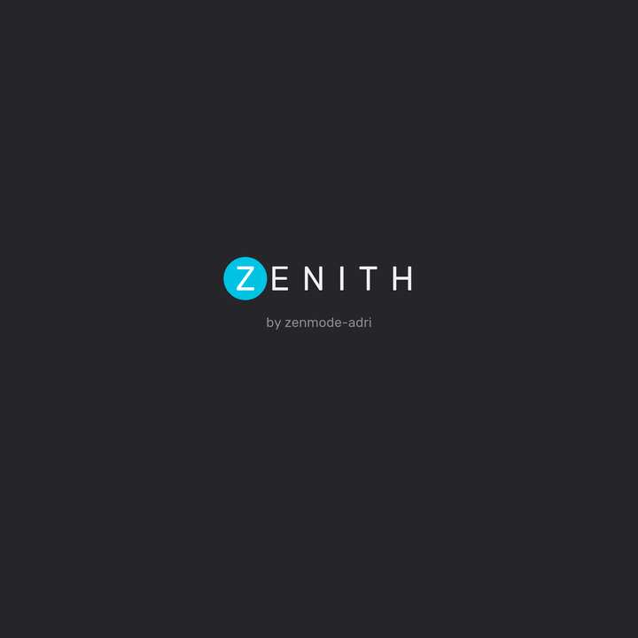
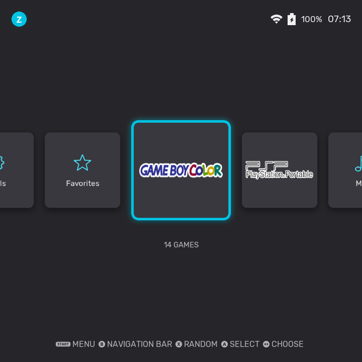
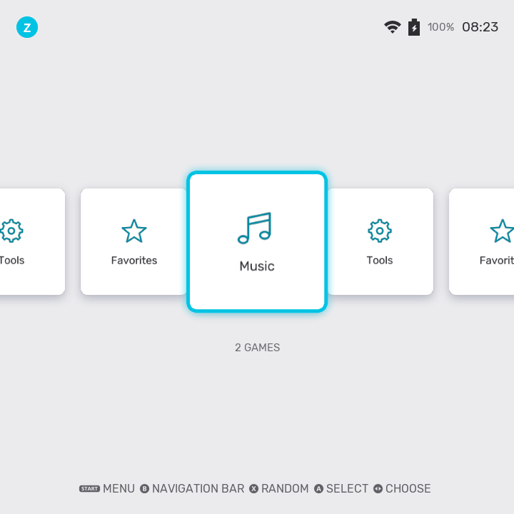
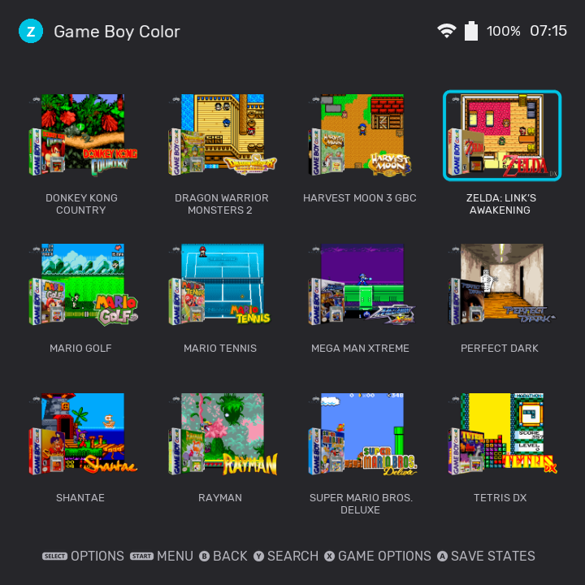
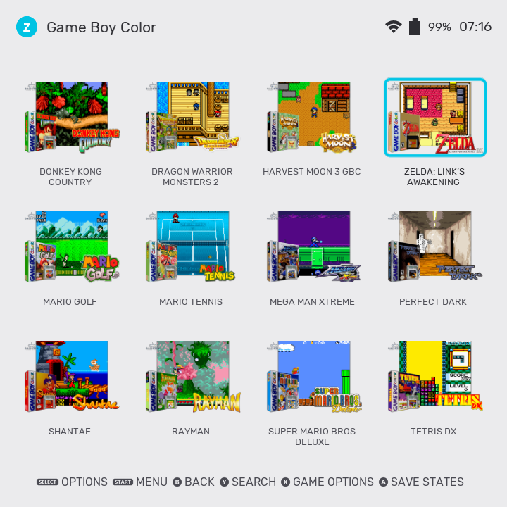
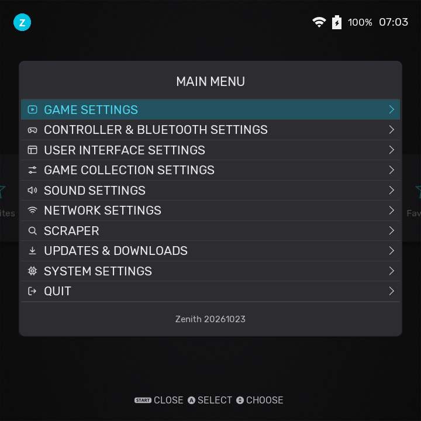

<p align="center">
  
</p>

<h3 align="center">A fast, polished operating system for RK3326 handhelds</h3>

<p align="center">
  <a href="https://github.com/zenmode-adri/Zenith/releases"></a>
  <a href="https://github.com/zenmode-adri/Zenith/releases"></a>
  
  
  
  <a href="https://ko-fi.com/zenmodeadri"></a>
</p>

Zenith is its own system image: Linux 6.12 mainline, EmulationStation with a custom light/dark theme, and a boot and
suspend path tuned for speed. It is an **unofficial fork** of
[AURKNIX](https://github.com/AveyondFly/distribution_rocknix), which is a fork of [ROCKNIX](https://github.com/ROCKNIX),
developed and measured on the **R36 Ultra**.

> [!WARNING]
> **Tested only on the R36 Ultra.** Other RK3326 handhelds use the same image and device-tree selector but have not been
> checked with these changes. Targets other than RK3326 are inherited from upstream and were not built or tested.
> Zenith is not endorsed by, or affiliated with, ROCKNIX, AURKNIX or their authors; please do not report Zenith problems
> to them.

## Features

- **Fast boot**: about **15 s** from power-on to the menu (33 s before). GPU, display, Sway and EmulationStation start in
  parallel as soon as storage is ready.
- **Fast suspend**: the console sleeps in **2.3 s** and wakes in **4.3 s**.
- **Games open in 3.85 s** (6.29 s before), and the menus answer on the first button press (**11 ms**).
- **Own interface**: light and dark theme, redesigned dialogs, keyboard, sliders and carousel, a clean Tools menu and
  first-boot screens.
- **Mainline kernel**: Linux 6.12 with upstream drivers, plus a patch set for the RK3326.
- **R36 Tuner Next** built in: CPU governor and frequencies, turbo steps, benchmarks and a monitor.
- **zfront**, an optional lighter front-end next to EmulationStation (which stays the default): first screen in 1.0 s instead
  of 4.1 s and about a quarter of the memory. See [`docs/ZFRONT.md`](docs/ZFRONT.md).
- **Zenith DTB Selector** to pick the right screen/device tree for your console from Windows, Linux or macOS, with a test
  mode for clones whose model is unknown. See [`docs/DTB-SELECTOR.md`](docs/DTB-SELECTOR.md).

## Screenshots

<table>
<tr>
<td align="center"><br/><sub>Start-up</sub></td>
<td align="center"><br/><sub>Main menu, dark</sub></td>
<td align="center"><br/><sub>Main menu, light</sub></td>
</tr>
<tr>
<td align="center"><br/><sub>Game grid with box art, dark</sub></td>
<td align="center"><br/><sub>Game grid with box art, light</sub></td>
<td align="center"><br/><sub>Settings menu</sub></td>
</tr>
</table>

---

## What changed

Measured on an **R36 Ultra**. Details and the git tag of every change are in [`CHANGELOG.md`](CHANGELOG.md). More
measurements, with charts: [`docs/COMPILER-STUDY.md`](docs/COMPILER-STUDY.md) (does compiling the emulators differently
make them faster? Mostly no) and [`docs/DTB-SELECTOR.md`](docs/DTB-SELECTOR.md).

| | AURKNIX (base) | Zenith | Change |
|---|---:|---:|---:|
| Power-on to menu | 33 s | **15 s** | **-53 %** |
| Opening a game | 6.29 s | **3.85 s** | **-39 %** |
| Suspend | 3.5 s | **2.3 s** | **-34 %** |
| Resume | 8 s | **4.3 s** | **-46 %** |
| First button press after idle | 225-245 ms | **11 ms** | **-95 %** |

> AURKNIX is the base image Zenith started from. Zenith's boot time comes from the boot log plus the bootloader
> (3.11 s -> 2.11 s).
>
> Thanks to AURKNIX and ROCKNIX for the base these numbers start from.

### zfront vs EmulationStation

zfront is an optional second front-end, written from scratch and installed next to EmulationStation (ES). It reads the same
settings, gamelists, theme and scripts, so you can switch back and forth from `Tools > Switch frontend`. Measured on an
**R36 Ultra** (one run each, not a statistical benchmark):

| | EmulationStation | zfront |
|---|---:|---:|
| First screen after start (large library) | 4.1 s | **1.0 s** |
| Front-end memory in the menus | 143 MB | **36 MB** |
| Front-end memory while a game runs | 170 MB | **22.5 MB** |
| CPU when idle (ticks per 10 s) | 35 | **2** |
| Start RetroArch from the front-end | 1.18 s | **0.91 s** |

It does **not** make games faster: in God of War (the only game measured) the frame rate is the same with both. ES is still
the default; zfront has not been tried yet on the console with a physical pad, real sound or suspend from its menu.

### Boot and power
- GPU, display, Sway and EmulationStation start in parallel as soon as storage is ready; u-boot `BOOTDELAY=0`; faster SD
  probing in the initramfs.
- Suspend runs Wi-Fi shutdown, panel and the rest in parallel; governors are restored first on wake-up.
- Silent shutdown (no red message) and quiet boot.

### Interface
- Own light and dark EmulationStation theme, readable card labels and higher contrast.
- Redesigned switches, sliders, keyboard, dialogs, scrollbars and Information screen (ES patches 0001-0054).
- System carousel with equal 22 px gaps, no jumping neighbours and a steady speed when holding a direction.
- System / Network Settings open at once and fill their lists in the background; faster Wi-Fi menu.
- Fewer confirmation prompts in the quit menu.
- Tools menu with an icon and a description for every tool; 15 dead entries removed.
- Own first-boot screens, language question and boot banner.
- **zfront, an optional second front-end** written from scratch in C++17 and installed next to EmulationStation, which stays
  the default (`Tools > Switch frontend`). Same settings, gamelists, theme and scripts. On an R36 Ultra: first screen in
  1.0 s instead of 4.1 s, 36 MB of memory instead of 143 MB, almost no CPU when idle; in the only game measured (God of
  War) the frame rate is the same as with EmulationStation. Still unchecked on the console: a physical pad, real sound and
  suspend from its menu. Details in [`docs/ZFRONT.md`](docs/ZFRONT.md) and the [CHANGELOG](CHANGELOG.md).

### Opening games and graphics
- RetroArch games start 0.2-0.5 s faster: the script that writes the per-game configuration went from about 220 processes to
  about 40 and produces byte-identical files (compared on 14 systems).
- **The open-source GPU driver (Panfrost) now works on the RK3326**, so the `GPU DRIVER` choice in the menu is usable (kernel
  patch `036-opp-single-voltage-is-minimum`; before it, choosing Panfrost left the console on software rendering). If it
  fails to bind the GPU at boot, the system saves libmali and reboots once.
- **libmali stays the default because Panfrost is not faster:** in God of War (1x, automatic governors) Panfrost was 5 %
  slower; with frame skip off at 2x/3x/4x libmali was 48 %/24 %/7 % faster; Mario Kart 64 36 vs 32 fps; glmark2 tied.
  Only those tests were done.

### Choosing the right device tree
- **Zenith DTB Selector** (Windows, Linux, macOS; window in English, Spanish and Chinese): finds the SD card, lists 86 models,
  shows what will change before writing, keeps dated backups of `extlinux.conf` and can import your own `.dtb`.
- **Test mode** for consoles whose DTB cannot be guessed: on each boot it tries the next candidate until you hold a button.
  **Not yet tested on hardware.**

### R36 Ultra hardware
- RK915 Wi-Fi driver fixes, joystick RGB LED driver, RK817 battery gauge, CPU/GPU voltage bins
  L0-L3 through PVTM, GPU table 200-600 MHz.

> [!NOTE]
> Zenith adds no new emulators and does not update cores; those come from AURKNIX. The work is on boot, suspend,
> responsiveness and the interface.

---

## Under the hood

**Kernel.** Zenith runs **Linux 6.12 mainline** (6.12.79 in the current image), with upstream drivers for the SoC, storage and
power management, on a long-term-support base. The 6.12 base comes from AURKNIX/ROCKNIX. The patch set on top of it is in
`projects/ROCKNIX/devices/RK3326/patches/linux/` (part inherited, part Zenith's own, see the changelog) and includes, among
others:

- CPU/GPU voltage bins L0-L3 read through PVTM and an RK3326 OPP table (CPU 1296 MHz by default, with 1416 and 1512 MHz as an
  opt-in turbo; GPU 200-600 MHz).
- Memory (DMC) frequency scaling, ported from the Rockchip 6.1 BSP by KK (AveyondFly) of AURKNIX: the DDR clock follows the load between
  194 and 666 MHz.
- RK915 Wi-Fi driver fixes and the RK817 battery gauge fixes.
- The R36 Ultra joystick RGB LED driver and a panel brightness control.
- An exFAT directory-readahead limit.

**Suspend to RAM.** Suspending with the power button is a real suspend-to-RAM (PSCI `mem`/deep sleep): the CPU rail is powered
off and the memory rail is lowered while the console sleeps (about 20-25 mA, estimated from the battery counter). Making it
reliable on these devices relies on upstream fixes that Zenith carries:

- SD card resume retried after a power cycle, and USB (dwc2) suspend/resume fixes: ROCKNIX pull requests #3304 and #3303,
  by Jacob Cook.
- RK817 battery gauge corrected across sleep, and the `SYS_CAN_SD` register cleared by default, as the vendor kernel does:
  ROCKNIX pull request #3305, by Chris Morgan.

On top of that, Zenith adds the RK915 Wi-Fi unload/reload around sleep, suspend steps that run in parallel,
CPU/GPU/memory governors restored first on wake-up, a "Suspending..." notice
that stays on screen for at least one second, and a fix that makes sure the backlight is always on after waking.

The kernel configuration was reviewed for performance: it is already lightweight (`-O2`, no debugging or tracing,
zram and MGLRU enabled), and the Cortex-A35 reports "not affected" for almost every speculative-execution mitigation, so
there is no security tax to remove.

**Boot.** A small initramfs probes the SD card every 50 ms and hands over to systemd with `exec`; GPU, display, Sway and
EmulationStation then start in parallel as soon as storage is ready, and the early start disables itself if EmulationStation
is not ready in time. u-boot runs with `BOOTDELAY=0`.

**EmulationStation.** 54 patches on top of `ROCKNIX/emulationstation-next` (`projects/ROCKNIX/packages/ui/emulationstation/patches/RK3326/`)
cover the interface, the carousel, audio wake-up, the quit menu and the Wi-Fi and settings menus.

## Tested and not shipped

Newer emulator builds, PPSSPP versions and GPU clocks were benchmarked on the R36 Ultra, and a change that did not help
was not shipped. Everything below was measured on the device.

### Newer emulator cores (ROCKNIX `next` branch)

19 libretro cores were rebuilt from the `next` branch and compared with the installed ones. The main comparisons used 32
ROMs with 4 repetitions each (RetroArch 1.22.2, same governor, temperature capped at 68 °C); only CPU time was measured,
not audio or save states.

| Core | CPU per frame, old -> new | Result |
|---|---:|---|
| snes9x, genesis_plus_gx, picodrive, gambatte, vba_next, quicknes | -1.4 % to +1.1 % | ✅ Same speed, no reason to change |
| nestopia (default NES core) | **+19 %** | ⚠️ More CPU on all 6 ROMs, not updated |
| fceumm | **+13 %** | ⚠️ More CPU, not updated |
| gearsystem (Game Gear / Master System) | **-26 %** | ✅ The only clear gain, candidate for a future image |
| mGBA, new vs old | **-42 %** | ⚠️ Better than before, but the default gpSP (GBA) and gambatte (GB/GBC) still use less CPU |

In these tests newer builds did not bring more performance in general: most are equivalent, two use more CPU, and mGBA
improves on its older version but not on the default cores. So Zenith keeps the cores that AURKNIX ships.

### PPSSPP

Versions 1.12.3 and 1.20 were compared on three games, and 12 settings were tried one at a time on a set of ten games run
from save states.

| Test | Result |
|---|---|
| Best version | No winner: 1.20 wins in some games, 1.12.3 in others |
| Profile-guided optimisation | **+2.5 %**, not the hoped 15 % |
| `SkipBufferEffects` | Up to **+77 %** in God of War, but it breaks the picture ⚠️ |
| `FrameSkip = 3` (stock) | Stays: faster in heavy games |

### GPU clock and CPU turbo

| Setting | Result |
|---|---|
| GPU fixed at 520 or 560 MHz | ⚠️ Freezes the console within a second or two, whatever the voltage |
| GPU 200 / 300 / 400 / 600 MHz | ✅ Stable (frequency table 200/300/400/480/600 MHz) |
| CPU 1416 MHz at 1350 mV | ✅ Stable on four cores |
| CPU 1512 MHz on four cores | ⚠️ Rebooted the console, not used by default |

---

## Install

1. Download `AURKNIX-RK3326.aarch64-<date>.img.gz` from the [Releases](https://github.com/zenmode-adri/Zenith/releases) page
   and check the `.sha256`.
2. Decompress it and write it to an SD card with an imaging tool (Balena Etcher, Raspberry Pi Imager, `dd`).
   Double-check the target disk: writing an image overwrites everything on it.
3. For a device other than the R36 Ultra, pick its device tree with **Zenith DTB Selector** (`ZenithDtbSelector.exe` on the
   root of the boot partition, also for Linux and macOS): see [`docs/DTB-SELECTOR.md`](docs/DTB-SELECTOR.md). If your
   console is not on the list, its test mode can try the candidates for you (not yet tested on hardware).

## Building

```bash
PROJECT=ROCKNIX DEVICE=RK3326 ARCH=aarch64 ./scripts/build_distro
```

A full build needs several hours and about 100 GB of free disk. Keep at least 6 GB free on the drive that holds the
images, or the last step (copying the image) can fail.

---

## About this fork

Zenith is an unofficial fork. The device and emulator lists, features and manuals of the base distribution are
documented upstream, not here:

- [AURKNIX](https://github.com/AveyondFly/distribution_rocknix) by **lcdyk** and **KK** (GitHub: AveyondFly): the fork Zenith is built on.
- [ROCKNIX](https://github.com/ROCKNIX): the distribution AURKNIX is forked from.

Everything else in the repository comes from them. What Zenith adds or changes is listed in
[`CHANGELOG.md`](CHANGELOG.md) and [`ZENITH.md`](ZENITH.md). Maintained by
[zenmode-adri](https://github.com/zenmode-adri); see [`CREDITS.md`](CREDITS.md) for the people and projects this work
stands on.

## Licenses

**AURKNIX** is a fork of **ROCKNIX**; ROCKNIX derives from [JELOS](https://github.com/JustEnoughLinuxOS/distribution/). All applicable licenses apply and credit to the JELOS and ROCKNIX teams. 

You are free to:

- Share: copy and redistribute the material in any medium or format
- Adapt: remix, transform, and build upon the material

Under the following terms:

- Attribution: You must give appropriate credit, provide a link to the license, and indicate if changes were made. You may do so in any reasonable manner, but not in any way that suggests the licensor endorses you or your use.
- NonCommercial: You may not use the material for commercial purposes.
- ShareAlike: If you remix, transform, or build upon the material, you must distribute your contributions under the same license as the original.

### Bundled Works
All other software is provided under each component's respective license. These licenses can be found in the software sources or in this project's licenses folder. Modifications to bundled software and scripts by the JELOS and ROCKNIX teams are licensed under the terms of the software being modified.

## Credits

Zenith exists thanks to **lcdyk** and **KK** (GitHub: **AveyondFly**), the authors of AURKNIX, whose RK3326 device trees,
emulators and tooling this fork is built on. Thank you.

Thanks also to the **ROCKNIX** and **JELOS** teams, and to CoreELEC, LibreELEC and the many open source developers
whose work makes a distribution like this possible. See [`CREDITS.md`](CREDITS.md) for the full list.

If you would like to support **lcdyk**, maintainer of AURKNIX, you can use Ko-fi: [https://ko-fi.com/lcdyk](https://ko-fi.com/lcdyk).
