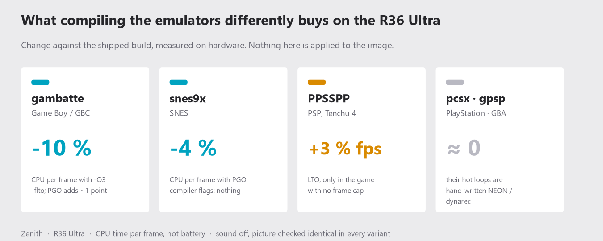
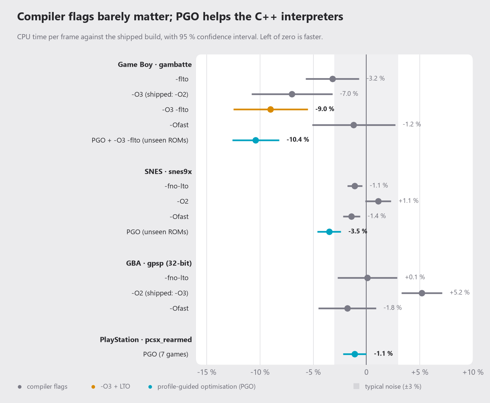
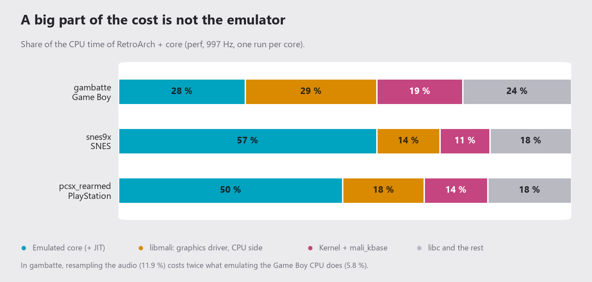
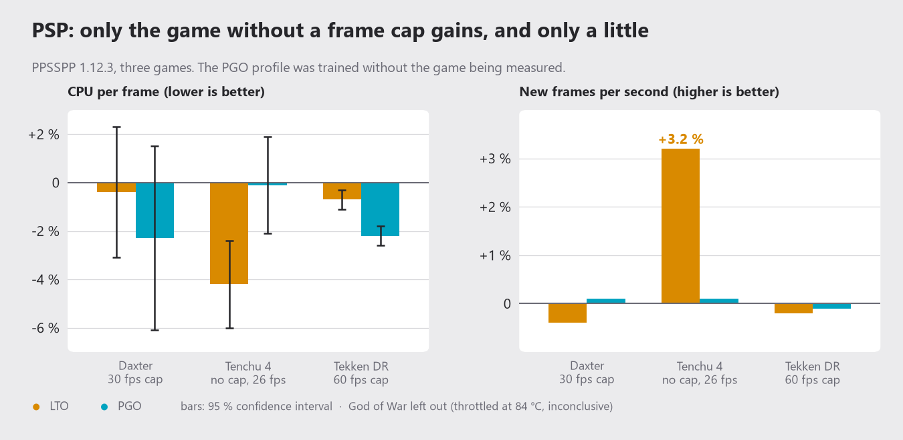

# Does compiling the emulators differently make them faster?

**Short answer: mostly no.** On the R36 Ultra, changing compiler flags in the emulator cores moves the CPU use by about
as much as the measurement noise (±3 %). Only two things showed a real gain: `-O3` + LTO on **gambatte** (Game Boy,
about -10 % CPU) and profile-guided optimisation (PGO) on **snes9x** (about -4 %). Nothing in this study is applied to
the Zenith image: it is a measurement report, plus a short list of what could be done.

<picture>
  <source media="(prefers-color-scheme: dark)" srcset="compiler-study/study-0-summary-dark.png">
  
</picture>

> **Read this first.** All numbers are **CPU time per emulated frame**, not battery. The console was plugged in, so real
> battery life was not measured (the fuel gauge only reports `current_avg`). A 10 % lower CPU use on a core that spends
> 3.5 ms of a 16.7 ms frame is not something you can feel; it is worth a fraction of a percent of total consumption
> (an estimate, not a measurement). All tests ran **with the sound off**.

## How it was measured

- **Hardware:** one R36 Ultra, Zenith DEBUG image, CPU fixed at 1296 MHz (1247 MHz for the Game Boy batch, constant across
  variants), cooled to 62 °C or less between runs.
- **Variants:** each core was rebuilt with the flags under test, **interleaved in rotating order** with the production
  `.so` and with a *control* build (production flags, rebuilt by me). The control must perform like production; it did
  (within 0.6 % in every batch, except gpsp: +1.4 % ±3.7, which is noise).
- **Same output:** for every variant and ROM, a screenshot at a fixed frame was **byte-for-byte identical** to the
  production one, so no variant changed what is drawn.
- **Statistics:** 3 to 5 repetitions per ROM and variant; the bars in the charts are the 95 % confidence interval of the
  mean change. A result inside the grey band (±3 %) should be read as "no difference".
- **PGO honesty:** profiles were trained on some ROMs and measured on **other ROMs** (for PSP, on a profile trained
  *without* the game being measured). Training on the games you measure inflates the result by about 1 point on snes9x.
- **Counting frames:** for PSP only *new* frames count (a small LD_PRELOAD logger counts real buffer swaps), because the
  emulator can repeat frames.

## 1. Compiler flags and PGO, per core

<picture>
  <source media="(prefers-color-scheme: dark)" srcset="compiler-study/study-1-flags-and-pgo-dark.png">
  
</picture>

| Core | What helps | What does not |
|---|---|---|
| **gambatte** (Game Boy / GBC) | `-O3 -flto`: **-9 %** (-9.5 % on ROMs not used for training). PGO on top: -10 % to -11 %, but the extra 1-2 points are inside the noise. | `-Ofast` (the core is integer code), `-fno-plt`. |
| **snes9x** (SNES) | PGO: **-4 %** on unseen ROMs (-5 % on the training ROMs). Its Makefile already builds with `-O3 -flto`. | `-Ofast` on top of PGO (+1 point, at the edge of the noise), `-O2`, `-fno-lto` (all within ±1.7 %). |
| **gpsp** (GBA, 32-bit) | Nothing. `-O2` is **5 % worse** than the `-O3` it ships with. | `-Ofast`, `-fno-lto`, `-mthumb`. It has its own assembly dynarec, so the compiler hardly matters. |
| **pcsx_rearmed** (PlayStation, 32-bit) | Nothing. PGO: -1.1 % ±1.1. | Every flag (all between -0.4 % and +0.6 %). 47 % of its time is hand-written NEON in the GPU renderer, which neither `-O` nor LTO rewrites. |

A PGO profile trained at `-O2` cannot be used to rebuild at `-O3` (GCC reports `coverage-mismatch`: the code structure
changes with the level), so to combine PGO with `-O3 -flto` the instrumented build must use the same flags. The
instrumented binary also needs `-static-libgcc`, because the toolchain's libgcov uses outline atomics that the `.so`
cannot resolve.

## 2. Where the time actually goes

<picture>
  <source media="(prefers-color-scheme: dark)" srcset="compiler-study/study-2-where-the-time-goes-dark.png">
  
</picture>

`perf` at 997 Hz on RetroArch plus the core. In these light cores a big part of the cost is **not the emulator**: showing
the picture through `libmali` takes 14-29 % of the CPU, and the kernel (with `mali_kbase`) another 11-19 %. No flag of
the core touches that. In gambatte, resampling the audio (`blipper_push_samples_fixed`, 11.9 %) costs twice what
emulating the Game Boy CPU does (`CPU::process`, 5.8 %).

## 3. PSP (PPSSPP 1.12.3, the default core)

<picture>
  <source media="(prefers-color-scheme: dark)" srcset="compiler-study/study-3-psp-lto-pgo-dark.png">
  
</picture>

Save states were created by hand in the same build and loaded with `--state`; the ini was equalised (no frame skip, no
30 fps limit, `RenderDuplicateFrames=False`).

- **LTO** only matters where the game does not reach its cap. *Tenchu 4* runs without a cap at 26 fps, with CPU to
  spare: LTO gives **+3.2 % fps** and fewer stutters (12.7 % -> 6.2 % of frames). It reproduced across two rounds (+2.7 %,
  +3.2 %). *Daxter* (30 fps cap) and *Tekken Dark Resurrection* (60 fps cap) were already at their cap: about 1 % less
  CPU, inside the noise.
- **PGO** gives nothing measurable once the profile is trained without the game being measured (at most -2 % CPU on the
  capped games, 0 on Tenchu). This agrees with an earlier study on PPSSPP 1.20.2 (+2.5 % on average).
- **God of War** (12.5 fps, 84 °C, above the 80 °C ceiling; two of 25 runs throttled) is limited by the Mali driver and
  the temperature, not by how the emulator is compiled. Its numbers are *not conclusive* and are not in the chart.

## 4. EmulationStation

PGO for EmulationStation itself is **not worth it**. With `perf record -a`, ES's own code is about 9 % of its CPU
while starting up and about 22 % while scrolling the carousel; the rest is `libmali`, the dynamic linker (`ld-linux`
alone is about 16 % of ES's start-up CPU, roughly 0.75 s spread over cores), image and font libraries, and kernel work
such as squashfs LZO decompression. Even a 15 % PGO gain on ES's own code would be 1-3 % of its CPU.

## What we learned

1. **Loose compiler flags almost never matter** in these cores: they already ship at `-O2`/`-O3`/LTO, their hot loops are
   hand-written NEON or assembly (pcsx, gpsp), or the time is in the graphics driver and the audio.
2. **What does move something** is `-O3` + LTO (+ PGO on C++ interpreter-style cores): gambatte about -10 % CPU, snes9x
   about -4 % with PGO, pcsx -1 %, gpsp nothing, PSP +3 % fps in the only uncapped game.
3. **PGO overfits to its training ROMs** (a little on gambatte, about 1 point on snes9x). Always measure on different
   ROMs.
4. **Measuring well costs more than compiling:** rotate the variants, check the picture is identical, cool the console
   between runs, and always report a confidence interval. Without those, the "±2 %" you see is noise.
5. **Honest limits:** this is emulator CPU, not battery; one console, one SD card, one governor setting.

## What could be done (none of it is applied)

- A branch with `-O3 -flto` for gambatte (about -9.5 %, maintenance cost near zero).
- snes9x PGO (about -4 %) would need a new profile with every core update: probably not worth it unless real battery
  measurements justify it.
- LTO in `ppsspp2021`, only if the +3 % also shows up in other uncapped games.
- Measure real battery with the console unplugged (10 minutes per variant) before deciding anything about PGO.
- Leave pcsx and gpsp alone: their speed is in hand-written code.

## A note on the numbers

Absolute figures for some unrelated tests in the same sessions (for example sway's log size) were affected by a mistake
in our own SSH test setup: the benchmarks were launched without the profile's `MALI_WAYLAND_AFBC=0`. The relative
comparisons above are not affected, because every variant ran under identical conditions and the picture was checked
to be identical.

The charts are generated by [`compiler-study/make_charts.py`](compiler-study/make_charts.py) from the numbers in the
tables above.
