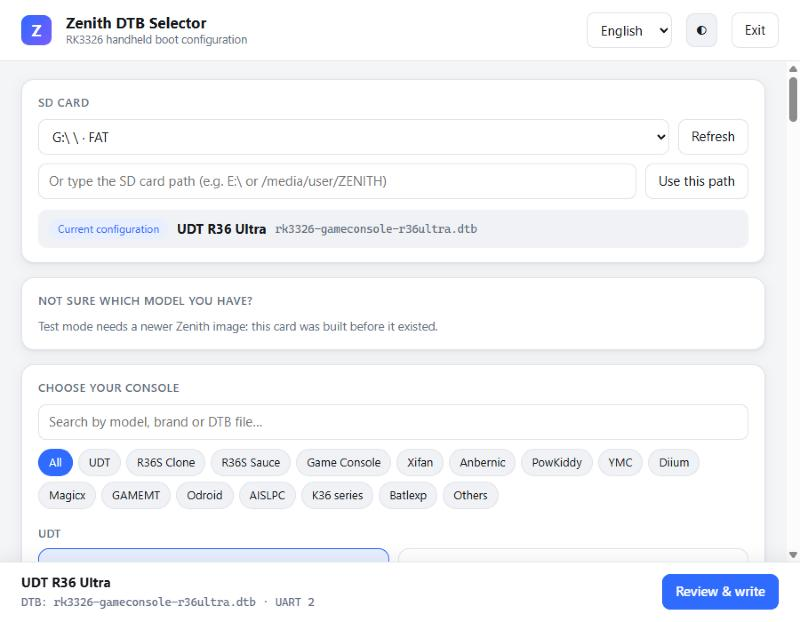
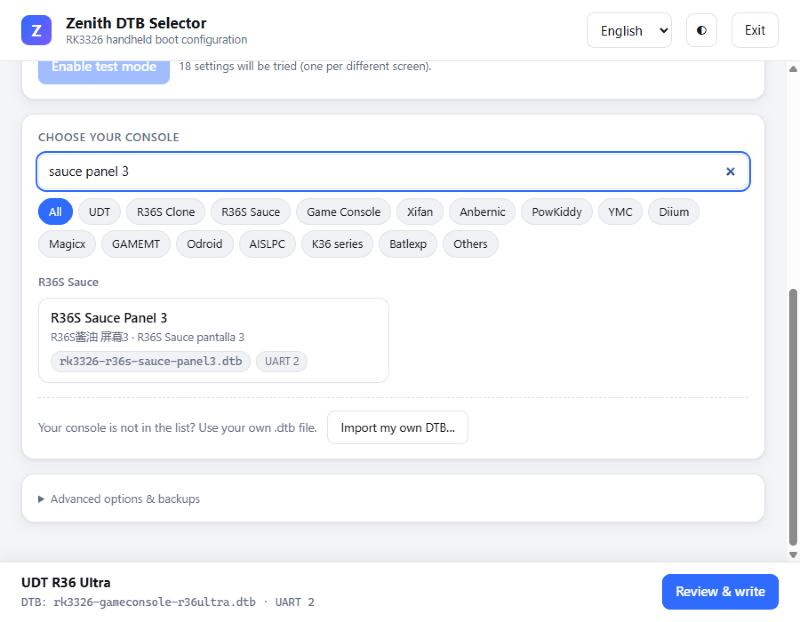
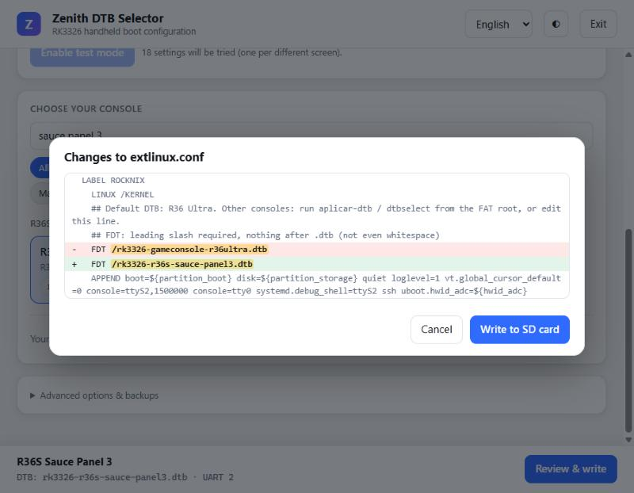
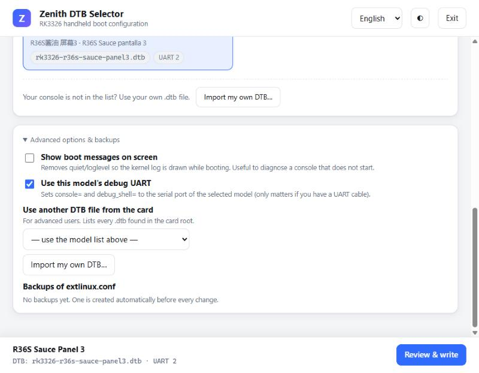
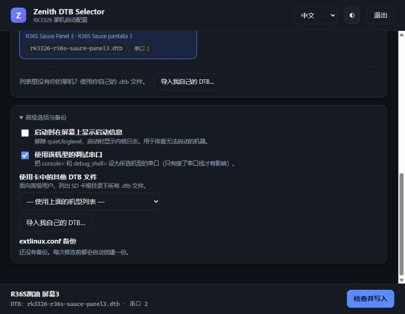
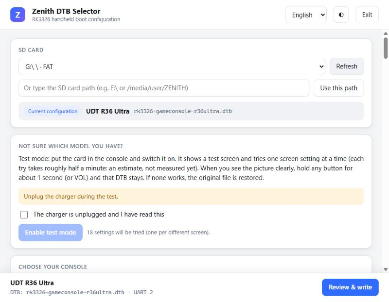
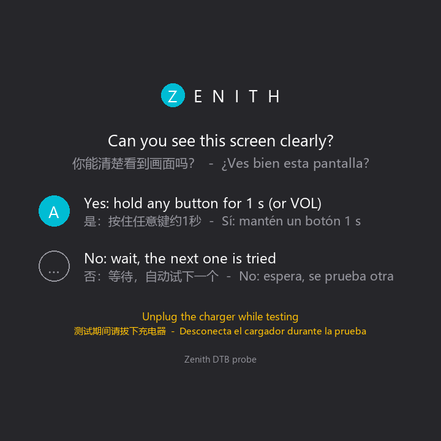

# Zenith DTB Selector

Every RK3326 handheld needs the right **device tree** (DTB): the file that tells the kernel which screen, buttons,
Wi-Fi chip and amplifier the console has. The Zenith image boots with the DTB of the **R36 Ultra**; any other console has
to pick its own. **Zenith DTB Selector** does that from your PC: you put the SD card in the computer, choose the console
in a list, check what will change, and it writes the one line that matters in `extlinux/extlinux.conf`.

It replaces the old `DtbselectWin64.exe` / `dtbselect` pickers. It works on **Windows, Linux and macOS**, the window is
in **中文, English and Español**, and it needs no installation and no network access (it only talks to itself on
`127.0.0.1`, with a random token per run, and exits when you close the window).

> **Status.** Tested on a copy of the real card of an R36 Ultra and on the console itself (import a DTB, apply it, reboot
> with it, restore). **Not tested on any other model.** The *test mode* described below has **not been tested on
> hardware yet**.

## Using it

1. Switch the console off and put its SD card in the PC.
2. Open `ZenithDtbSelector.exe` (Windows). It is on the root of the card itself (`mkimage` copies it there) and in the
   repository at `projects/ROCKNIX/devices/RK3326/packages/rk3326-dtb-select/prebuilt/`. Linux and macOS binaries are
   built with `zenith-dtb-selector/build.sh` (Go 1.22 or newer). The exe is **not code-signed**: Windows SmartScreen may
   warn ("More info" > "Run anyway").
3. The tool finds the card by itself (a FAT volume that has `KERNEL` and `extlinux/extlinux.conf`). If it does not, type
   the path (`E:\` or `/media/you/ZENITH`) and press *Use this path*. The line **Current configuration** shows the DTB
   the card uses now.



4. Pick your console. There are 86 models, grouped by brand; the search box looks at the name, the brand and the `.dtb`
   file name. The R36S clone families keep their exact variants ("type 3 panel 2", "Sauce panel 4"...).
5. If your console is not on the list, press **Import my own DTB...**: it copies a `.dtb` from the PC to the root of the
   card (the header and size are validated, the name is reduced to a safe base name, and an existing file is never
   replaced without asking) and selects it.



6. Press **Review & write**. The tool shows the exact change, word by word, **before** writing. Nothing is written until
   you press *Write to SD card*.



7. Put the card back in the console and switch it on.

### What it changes, and what it does not

- It edits the card's **current** `extlinux.conf` instead of regenerating it, so your own options survive. It writes LF
  line endings and strips trailing whitespace (u-boot refuses to boot if anything follows `.dtb`).
- It changes the `FDT` line and, if you ask for it, a few boot options (see *Advanced*). It **never adds `ssh`**: SSH is
  opt-in from the system menu. An `ssh` flag that is already in the file is left as it is.
- Before every change it saves a dated copy in `extlinux/backups/` (the 30 newest are kept). Any copy can be restored
  from the tool, and restoring is itself backed up.
- It refuses to write if the chosen `.dtb` is not on the card, or if the volume does not look like a Zenith card.

### Advanced options and backups



- **Show boot messages on screen** removes `quiet loglevel=1`, to diagnose a console that does not start.
- **Use this model's debug UART** sets `console=` and `debug_shell=` to the serial port of the selected model (only
  matters if you have a UART cable).
- **Use another DTB file from the card** lists every `.dtb` in the card root.
- **Backups of extlinux.conf** lists the saved copies, with a *Restore* button.

### Languages and themes

The language selector (top right) switches between 中文, English and Español; the half-moon button toggles light and
dark.



## Test mode ("try the next one")

Some clone consoles share the same boot ID, so no program can tell which DTB they need. The test mode lets the console
try the candidates itself, one per boot, until you see a clear picture.

> **Not tested on hardware yet.** Read the safety notes below before using it, and try it first on a spare card.

**How it works**

1. In the selector, the *Not sure which model you have?* box offers **Enable test mode**. It only appears when the card
   carries a Zenith image that has the test-mode script (`zenith-features.txt` on the card contains `dtb-probe=1`;
   images built before it existed do not). Tick the box about unplugging the charger and press the button.



2. The selector writes `/flash/dtbprobe/` (state, candidate list, index and a copy of your original `extlinux.conf`)
   and puts the **first candidate** in `extlinux.conf`. By default it tries 18 DTBs, one per different screen, ordered so
   the likeliest come first (the list is `web/probe-order.json`).
3. Put the card in the console and switch it on. On every boot with test mode active, the console draws this card and
   waits **12 seconds** for a button:



   - **You see it clearly:** *hold any button of the pad for about 1 second* (or VOL+/VOL-; **not** the power button,
     which can trigger suspend). That DTB stays, test mode ends, and the boot continues.
   - **You see nothing, or garbage:** do nothing. After 12 s the next candidate is written and the console restarts by
     itself.
4. If the candidates run out, the original `extlinux.conf` is restored and the console restarts once more.

The card is drawn for several screen sizes (720x720, 640x480, 480x854, 1024x768, 720x1280).

**Safety**

- It only ever touches the **`FDT` line** of `extlinux.conf`. Writes are atomic (temporary file + rename) and checked.
- With no `/flash/dtbprobe/state` the script does nothing, so it cannot affect a normal boot.
- If `extlinux.conf` no longer points to the expected candidate (you changed it by hand or with the selector), test mode
  cancels itself. There is a cap on attempts so it cannot loop forever.
- To cancel it: run the selector's command line `--probe-stop`, or copy `/flash/dtbprobe/extlinux.orig` over
  `extlinux/extlinux.conf`.
- **A wrong DTB can drive the wrong panel or GPIOs.** Do not leave the console charging or connected to anything while
  testing. For a console whose DTB you already know (an R36 Ultra, say), use a short list with `--probe-list` instead of
  the default 18.

## Command line

```
ZenithDtbSelector --list                                  # list the models (id, DTB, UART, name)
ZenithDtbSelector --boot E:\ --apply udt-r36-ultra        # apply a model without the window
ZenithDtbSelector --boot E:\ --apply <id> --show-boot     # ...and show boot messages
ZenithDtbSelector --boot E:\ --probe-start [--probe-list a.dtb,b.dtb]
ZenithDtbSelector --boot E:\ --probe-status
ZenithDtbSelector --boot E:\ --probe-stop
```

## What was tested

On a copy of the real card of an R36 Ultra (77 DTBs):

- Applying the model the card already uses leaves `extlinux.conf` **byte for byte identical**.
- Applying another model changes only the `FDT` line; unknown ids, a missing DTB, a card without `KERNEL` and a file that is
  not a DTB are all refused; files with CRLF or trailing spaces after `.dtb` are normalised; a file with no `FDT` line
  gets one.
- A file name like `../../x.dtb` is reduced to `x.dtb` inside the card; the web interface answers 403 without its token.
- The catalogue (77 DTBs) matches the DTBs on the card, with none missing and none extra.

On the console itself: import of a DTB (an exact copy of the Ultra's with one inert extra property), apply, reboot (the
kernel really loaded that file), restore with the tool's own *Restore*, reboot again, back to the original.

**Not covered:** other console models, a real SD card auto-detected in Windows/macOS beyond a read-only check, and the
whole test mode on hardware.

Source: `projects/ROCKNIX/devices/RK3326/packages/rk3326-dtb-select/zenith-dtb-selector/` (Go, standard library only).
The device list comes from the legacy `dtb_selector.py` through `tools/gen_catalog.py`.
