# Panfrost vs libmali on the Mali-G31: 20 games, three drivers

**Short answer: a patched Panfrost is now as fast as Arm's libmali or faster in 19 of 20 games** on the R36S, and in all
20 on the R36 Ultra (a game counts as a tie within ±5 %). It is much faster than Panfrost as Mesa ships it. This is a
measurement report: **Zenith keeps libmali as the default for safety and compatibility, and the patched Panfrost is
built into the next image** (in the current release, the Panfrost in the `GPU DRIVER` menu is the stock one).

| | R36S | R36 Ultra |
|---|---:|---:|
| Patched Panfrost vs libmali: wins / ties (±5 %) / losses, out of 20 | **7 / 12 / 1** | **8 / 12 / 0** |
| Patched Panfrost vs libmali, geometric mean of the 20 games | **+4.4 %** | **+6.5 %** |
| Patched vs stock Panfrost, geometric mean | **+38.9 %** | **+38.9 %** |
| Stock Panfrost vs libmali, geometric mean | −24.8 % | −23.3 % |
| glmark2 score: libmali / stock / patched | 380 / 386 / **434** | 358 / 368 / **414** |

> **Read this first.** Games run in **uncapped fast-forward**, so the numbers show how much headroom each driver has.
> In normal play any game above 60 fps on all three drivers plays the same. All tests ran **with the sound off**.

## The three drivers

- **libmali:** Arm's closed driver (g24p0), the Zenith default.
- **Stock Panfrost:** the open driver as it comes in Mesa 26.0.4.
- **Patched Panfrost:** Mesa 26.0.4 with 19 patches, 17 of them active (006 and 007 are built in but switched off: they
  did not help). All are general: nothing is specific to a game. The library is also built with profile-guided
  optimisation (PGO) and link-time optimisation (LTO).
  - **Memory and readbacks:** keep buffer mappings when buffers are reused, copy index data to cached memory before
    scanning it, let the CPU read GPU images from cached memory, and only compute the CRC on buffers that reach the screen.
  - **Shader compiler:** turn the uniforms of the emulators' ubershaders into constants so the compiler removes branches
    and registers, plus better half-precision conversions and instruction scheduling on Bifrost.
  - **Threads and waiting:** allow Mesa's GL thread (glthread) on Panfrost, and keep up to three frames in flight
    instead of one.
  - **A bug fix:** the varying linkage between shaders was reused with the wrong fragment-shader variant, so the GPU read
    the wrong descriptors (page faults and GPU resets).
  - **Defaults:** all of the above is on at start-up, no environment variables needed.

## How it was measured

- **Hardware:** an R36S (640x480 screen) and an R36 Ultra (720x720), both RK3326 with a Mali-G31 MC1, the same Zenith
  build. CPU fixed at 1296 MHz, GPU at 600 MHz, RAM at 666 MHz, cooled to 62 °C or less before every run.
- **Same scene:** every game starts from the same save state, with the core options of a fresh install, in uncapped
  fast-forward without frame skipping. One short warm-up run, then two 15 s runs.
- **Same frames:** fps are counted over the same range of frames after loading the state for all three drivers, so a
  faster driver does not measure a different part of the scene.
- **Stock and patched Panfrost** ran interleaved in the same boot with the same settings (glthread on, except
  GoldenEye; stock Panfrost cannot use it and turns it off by itself).
- **No GPU faults** in any batch on either console.
- **Same picture:** for the 19 RetroArch games, a screenshot of the same frame (state loaded paused, 40 frames
  advanced one by one) was compared pixel by pixel. Stock and patched Panfrost give the same image in 18 of 19: the
  patches do not change what is drawn. libmali filters some textures slightly differently (Beetle Adventure Racing,
  Mega Man 64, Rocket, Fighter Destiny 2), with no visible errors. In Dead or Alive 2 stock Panfrost lands on a slightly
  different instant because Flycast does not advance identically every time; there the patched driver matches libmali
  exactly.

## libmali stops at 60 fps in fullscreen

Under RetroArch in **fullscreen, libmali never goes above 60 fps**: in 8 of the 20 games it spends more than half the
time pinned at 60. RetroArch asks for no vsync (`eglSwapInterval(0)`) and libmali accepts it, but nothing changes. With
RetroArch **windowed** (`video_fullscreen = false`) libmali runs free: on the R36 Ultra Castlevania: Aria of Sorrow goes
from 59.7 to 76.6 fps and Mega Man 64 from 58.1 to 123.8 fps. The likely
cause (not verified) is that in fullscreen sway shows the game's buffer directly and holds it until the next refresh,
and libmali uses too few buffers to keep working meanwhile. glmark2 runs in a window and never hit the cap.

So libmali was measured **both ways and each game uses its best result**. Windowed is not always better: for slow games
the compositor has to copy the image and fullscreen wins. Panfrost has no cap and was measured in fullscreen. On the
R36S, windowed libmali was measured in a separate boot.

## Results, R36S

| Game | System · core | libmali | Stock Panfrost | Patched Panfrost | Patched vs libmali | Patched vs stock |
|---|---|---:|---:|---:|---:|---:|
| God of War: Chains of Olympus ¹ | PSP · PPSSPP | 14.7 fullscreen | 11.9 | **22.3** | +52.0 % | +87.5 % |
| GoldenEye 007 ¹ | N64 · Mupen64Plus-Next | **44.0** fullscreen | 26.1 | 41.3 | −6.3 % | +57.9 % |
| Mario Kart 64 ¹ | N64 · ParaLLEl N64 | 33.6 windowed | 26.6 | **38.4** | +14.1 % | +44.0 % |
| Mario Kart 64 ¹ | N64 · Mupen64Plus-Next | **79.7** windowed | 49.0 | 79.3 | −0.5 % | +62.0 % |
| Zelda: Ocarina of Time ¹ | N64 · ParaLLEl N64 | 25.1 windowed | 21.6 | **28.7** | +14.6 % | +33.0 % |
| Mario Tennis | N64 · Mupen64Plus-Next | **22.9** fullscreen | 9.6 | 21.9 | −4.2 % | +127.6 % |
| Top Gear Rally 2 | N64 · Mupen64Plus-Next | 30.8 windowed | **31.3** | 30.6 | −0.8 % | −2.3 % |
| Rocket: Robot on Wheels ² | N64 · Mupen64Plus-Next | 66.0 windowed | 49.8 | **66.7** | +1.0 % | +33.8 % |
| Snowboard Kids 2 | N64 · Mupen64Plus-Next | **54.0** fullscreen | 40.9 | 52.6 | −2.7 % | +28.5 % |
| Beetle Adventure Racing ² | N64 · Mupen64Plus-Next | 29.5 windowed | **33.5** | 31.1 | +5.5 % | −7.2 % |
| Mega Man 64 | N64 · Mupen64Plus-Next | 127.8 windowed | 53.8 | **139.7** | +9.3 % | +159.9 % |
| Gex 3: Deep Cover Gecko | N64 · Mupen64Plus-Next | 71.7 windowed | 48.4 | **73.0** | +1.8 % | +50.7 % |
| Bomberman Hero | N64 · Mupen64Plus-Next | 74.6 windowed | 51.6 | **74.9** | +0.5 % | +45.3 % |
| Wave Race 64 | N64 · Mupen64Plus-Next | 57.0 windowed | 41.0 | **65.4** | +14.6 % | +59.3 % |
| Fighter Destiny 2 | N64 · Mupen64Plus-Next | **80.1** windowed | 49.7 | 78.0 | −2.7 % | +56.9 % |
| Road Rash 64 | N64 · Mupen64Plus-Next | 58.9 windowed | 52.1 | **62.5** | +6.2 % | +20.0 % |
| Dead or Alive 2 | Dreamcast · Flycast | 21.2 fullscreen | 20.0 | **21.2** | +0.3 % | +6.2 % |
| Marvel vs. Capcom 2 | Dreamcast · Flycast | 45.3 windowed | 44.0 | **45.8** | +1.0 % | +4.0 % |
| Castlevania: Aria of Sorrow | GBA · mGBA | **80.0** windowed | 72.6 | 78.6 | −1.7 % | +8.4 % |
| Bomberman Tournament | GBA · mGBA | **75.8** windowed | 69.5 | 74.2 | −2.1 % | +6.8 % |

## Results, R36 Ultra

| Game | System · core | libmali | Stock Panfrost | Patched Panfrost | Patched vs libmali | Patched vs stock |
|---|---|---:|---:|---:|---:|---:|
| God of War: Chains of Olympus ¹ | PSP · PPSSPP | 13.6 fullscreen | 10.9 | **21.2** | +56.0 % | +95.2 % |
| GoldenEye 007 ¹ | N64 · Mupen64Plus-Next | **42.0** fullscreen | 26.3 | 40.9 | −2.5 % | +55.2 % |
| Mario Kart 64 ¹ | N64 · ParaLLEl N64 | 32.2 fullscreen | 26.0 | **37.1** | +15.2 % | +43.0 % |
| Mario Kart 64 ¹ | N64 · Mupen64Plus-Next | 74.7 windowed | 47.5 | **77.9** | +4.3 % | +63.9 % |
| Zelda: Ocarina of Time ¹ | N64 · ParaLLEl N64 | 24.2 fullscreen | 21.4 | **28.1** | +16.2 % | +31.5 % |
| Mario Tennis | N64 · Mupen64Plus-Next | **21.9** fullscreen | 9.2 | 21.3 | −3.1 % | +130.6 % |
| Top Gear Rally 2 | N64 · Mupen64Plus-Next | 29.2 fullscreen | **30.0** | 29.6 | +1.1 % | −1.4 % |
| Rocket: Robot on Wheels ² | N64 · Mupen64Plus-Next | 62.1 windowed | 48.0 | **64.1** | +3.2 % | +33.6 % |
| Snowboard Kids 2 | N64 · Mupen64Plus-Next | **52.4** fullscreen | 39.3 | 50.5 | −3.6 % | +28.6 % |
| Beetle Adventure Racing ² | N64 · Mupen64Plus-Next | 28.7 windowed | **33.0** | 30.3 | +5.6 % | −8.2 % |
| Mega Man 64 | N64 · Mupen64Plus-Next | 123.8 windowed | 54.0 | **134.8** | +8.9 % | +149.5 % |
| Gex 3: Deep Cover Gecko | N64 · Mupen64Plus-Next | 68.1 windowed | 47.0 | **71.9** | +5.5 % | +53.0 % |
| Bomberman Hero | N64 · Mupen64Plus-Next | 69.5 windowed | 50.3 | **72.4** | +4.3 % | +44.0 % |
| Wave Race 64 | N64 · Mupen64Plus-Next | 53.6 windowed | 39.9 | **62.9** | +17.3 % | +57.7 % |
| Fighter Destiny 2 | N64 · Mupen64Plus-Next | 76.2 windowed | 47.4 | **76.8** | +0.7 % | +61.8 % |
| Road Rash 64 | N64 · Mupen64Plus-Next | 55.5 windowed | 50.3 | **59.4** | +6.9 % | +18.0 % |
| Dead or Alive 2 | Dreamcast · Flycast | 20.8 fullscreen | 19.9 | **21.0** | +1.1 % | +5.5 % |
| Marvel vs. Capcom 2 | Dreamcast · Flycast | 43.8 windowed | 43.4 | **45.1** | +3.0 % | +4.0 % |
| Castlevania: Aria of Sorrow | GBA · mGBA | 76.6 windowed | 70.5 | **76.9** | +0.4 % | +9.1 % |
| Bomberman Tournament | GBA · mGBA | 71.8 windowed | 68.1 | **73.1** | +1.8 % | +7.4 % |

fps, mean of two runs; the best of the three is in bold. ¹ One of the five games used to train the PGO profile (the
sixth training game, Tekken on PSP, is not in this study). ² The two runs of one driver differ by more than 10 %: treat
that row with care.

## glmark2

Full run of every scene, 720x720 window, GPU 600 MHz and RAM 666 MHz, mean of two runs.

| | libmali | Stock Panfrost | Patched Panfrost |
|---|---:|---:|---:|
| R36S | 380 | 386 | **434** |
| R36 Ultra | 358 | 368 | **414** |

## What this study does not say

- In fast-forward each driver shows its headroom. At normal speed, a game above 60 fps on all three plays the same.
- Five games were used to train the PGO profile, so their numbers may be slightly flattered. The gain also shows in
  games that were not used for training (Wave Race 64, Mega Man 64, Road Rash 64).
- Battery use and input latency were not measured. Keeping three frames in flight can add up to two frames of delay.
- The two Dreamcast games (Flycast) do not advance identically on every run, so their frame range may not match exactly
  between drivers; their numbers are a little less exact than the rest.
- No PlayStation games: the console has no BIOS for them.

## Screenshots (R36S)

Same frame on all three drivers, with the measured fps on top. God of War (PPSSPP) cannot be advanced frame by frame
this way: its picture is a live capture with the emulator's own counter.

**God of War: Chains of Olympus** (PSP · PPSSPP)

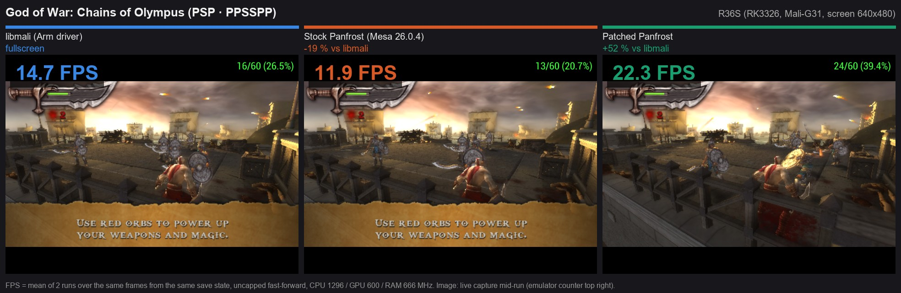

**GoldenEye 007** (N64 · Mupen64Plus-Next)

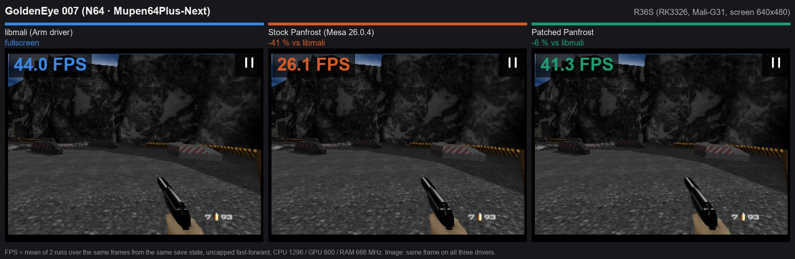

**Mario Kart 64** (N64 · ParaLLEl N64)

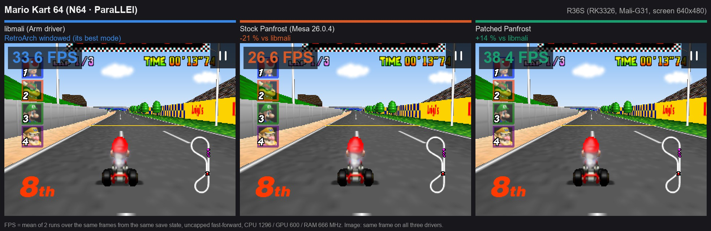

**Mario Kart 64** (N64 · Mupen64Plus-Next)

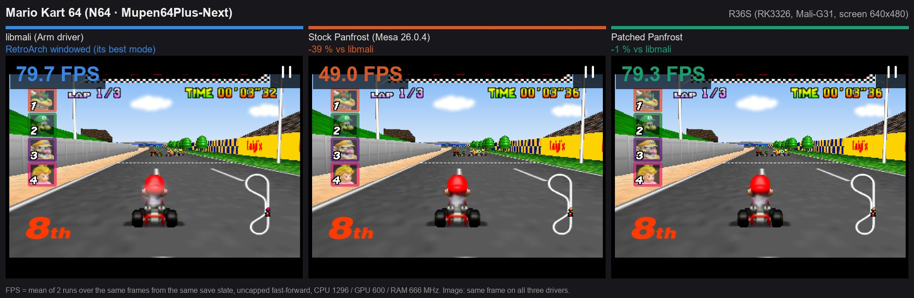

**Zelda: Ocarina of Time** (N64 · ParaLLEl N64)

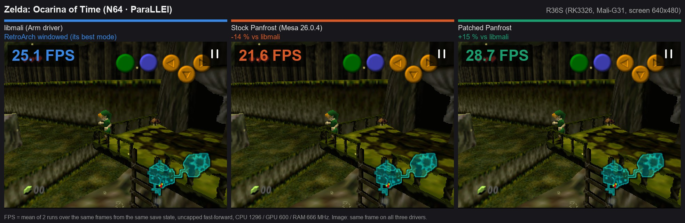

**Mario Tennis** (N64 · Mupen64Plus-Next)

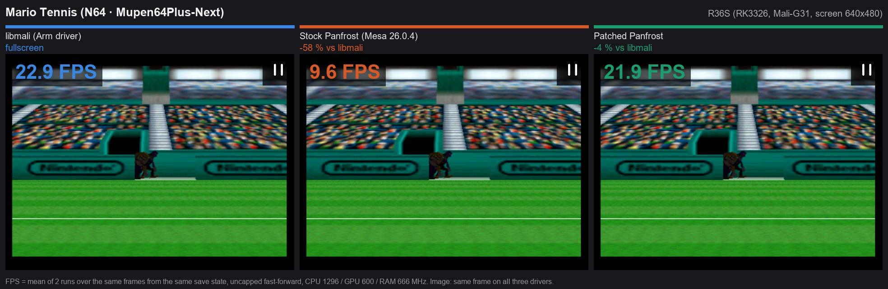

**Top Gear Rally 2** (N64 · Mupen64Plus-Next)

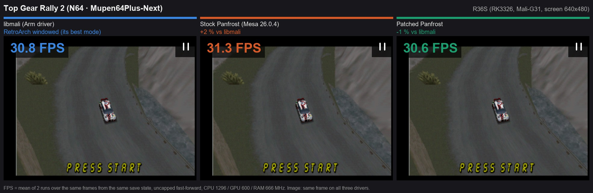

**Rocket: Robot on Wheels** (N64 · Mupen64Plus-Next)

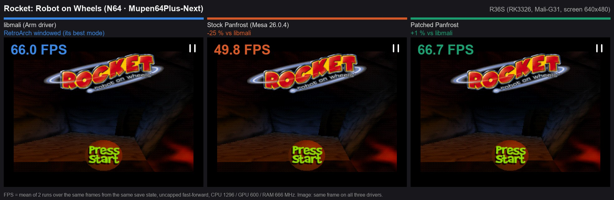

**Snowboard Kids 2** (N64 · Mupen64Plus-Next)

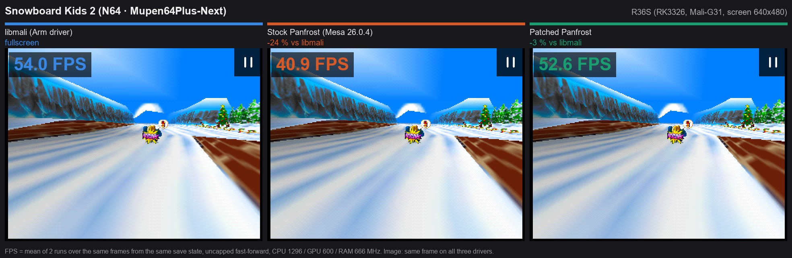

**Beetle Adventure Racing** (N64 · Mupen64Plus-Next)

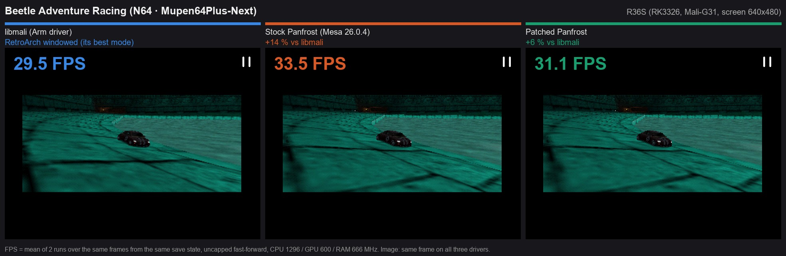

**Mega Man 64** (N64 · Mupen64Plus-Next)

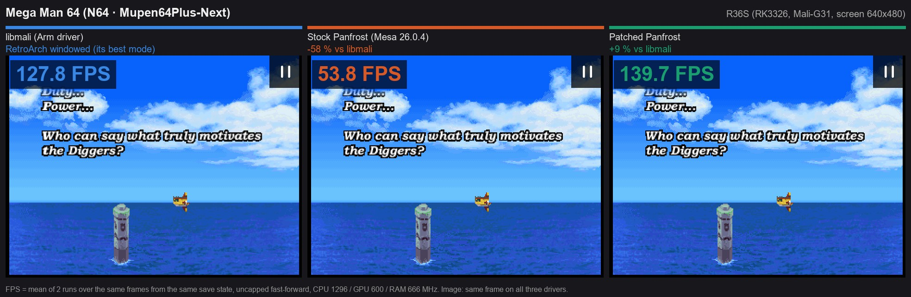

**Gex 3: Deep Cover Gecko** (N64 · Mupen64Plus-Next)

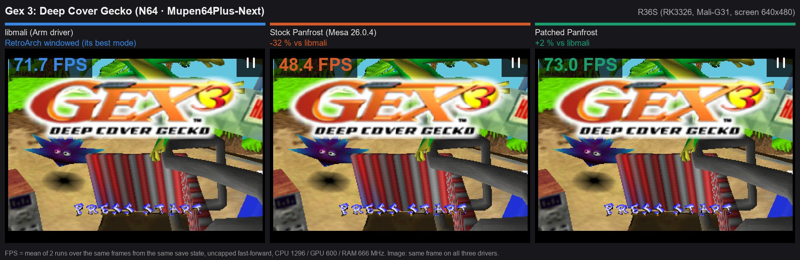

**Bomberman Hero** (N64 · Mupen64Plus-Next)

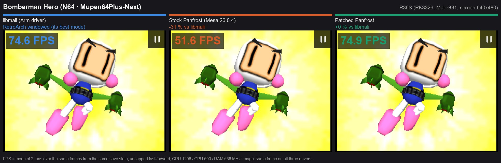

**Wave Race 64** (N64 · Mupen64Plus-Next)

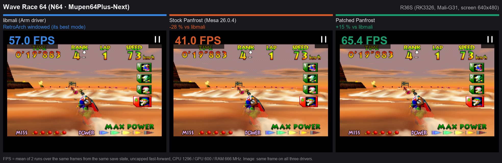

**Fighter Destiny 2** (N64 · Mupen64Plus-Next)

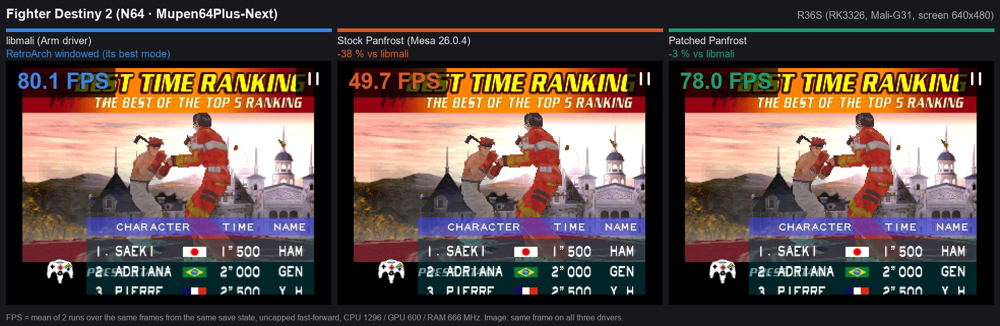

**Road Rash 64** (N64 · Mupen64Plus-Next)

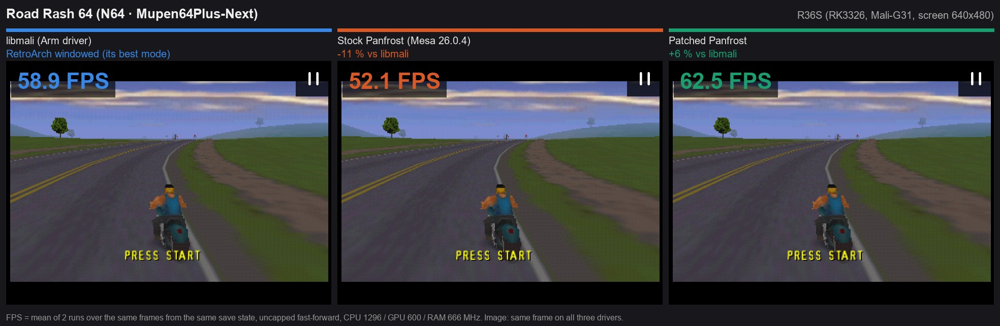

**Dead or Alive 2** (Dreamcast · Flycast)

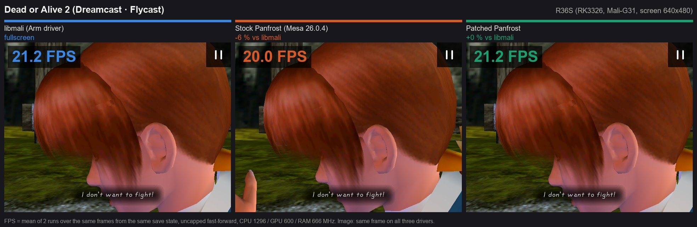

**Marvel vs. Capcom 2** (Dreamcast · Flycast)

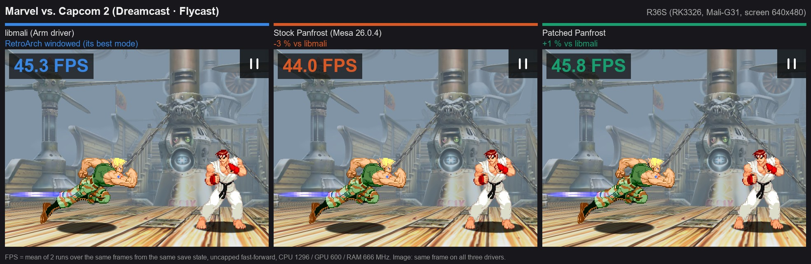

**Castlevania: Aria of Sorrow** (GBA · mGBA)

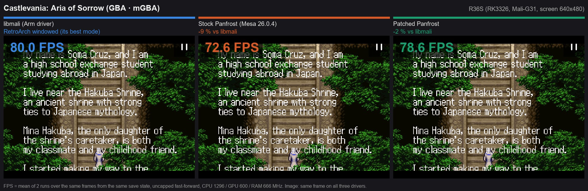

**Bomberman Tournament** (GBA · mGBA)

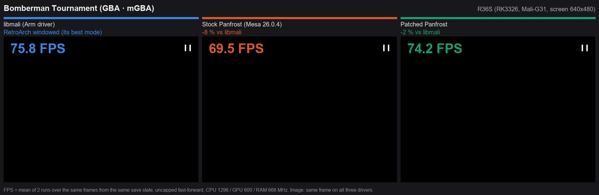
